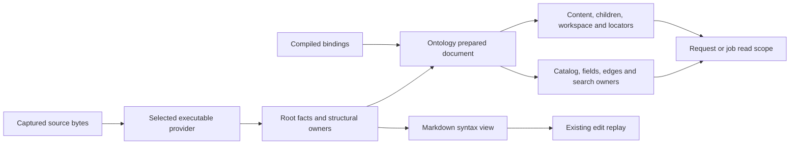

# SPEC-0133 foundation design

Status: accepted with the changes in [foundation review](foundation-review.md), incorporated below for Batch 1 implementation. This document specifies Batch 1 and Batch 3 implementation, not completed behavior. It changes no product code.

Contract: [SPEC-0133](../../specs/technical/format-neutral-embedded-nodes-and-ao-kb-adoption.md), R1 through R7 and Batches 1 through 5. Effort: [EFF-2026-11-06-17-07](../../efforts/2026-11-06-17-07-ao-kb-adoption.md). Inspected Rhizome revision: `438367ae55ab99849396bb86c70be1bda0b940ff`. References below identify that revision. `AO/` means `/Users/colthorp/Developer/atomic-ai-prompt-toolkit/` at `e9dce951ab4cd6aa9ccc734df96590bde25ccde9`; `AO/build/` abbreviates its `packages/kb-site/kb_site/kits/core/_build/` directory. AO was inspected read-only; no AO workflows were run.

The governing contracts are [structural nodes](../../specs/technical/structural-node-model-and-ontology-read-path.md), [providers](../../specs/technical/note-format-provider-registry.md), [indexing ownership](../../specs/technical/note-node-indexing-architecture.md), [source shapes](../../specs/technical/non-section-embedded-node-source-shapes.md), [locators](../../specs/technical/linkable-embedded-node-identifiers.md), [workspace capabilities](../../specs/technical/node-workspace-capability-pipeline.md), [indexed reads](../../specs/technical/ontology-indexed-read-model-contract.md), [edit replay](../../specs/technical/ontology-edit-replay-conflict-contract.md), [root projection](../../specs/technical/format-aware-root-ontology-projection.md), and [starter lifecycle](../../specs/product/init-starter-workflow.md). SPEC-0133 extends their Markdown-specific assumptions; existing Markdown behavior and HTML root-only behavior remain acceptance constraints.

## 1. Decision and current state

Extend `noteformat.ProjectionFacts` with a schema-free syntax ownership tree and a lossless semantic value tree. Ontology selects graph-worthy owners, assigns identity, binds fields, and resolves references. One prepared document supplies all reads for a captured host. Markdown edits retain their current syntax adapter and replay implementation. No provider imports ontology or knows an AO kind.



Today `pkg/noteformat/facts.go:148` carries root metadata, links, targets, and search regions, but no owners. `pkg/noteformat/markdown/provider.go:67` invokes shared syntax primitives for those facts. A second pass at `pkg/ontology/projection.go:197` parses sections and list spans into `DocumentSnapshot`. `pkg/ontology/projection_source.go:34` selects that pass by **structural mutation** capability. `pkg/ontology/noderead/projection.go:90` repeats that dispatch. A synthetic readable provider with children therefore cannot use the common structural read path.

`pkg/ontology/projection.go:55` defines canonical `NodeRef`; `:86` defines the Markdown snapshot; `:114` and `:141` define field and collection bindings. `pkg/ontology/schema/schema_compile_types.go:42` requires every embedded type to implement `Section`; `pkg/ontology/schema/schema_compile_fields.go:268` imposes inline defaults on embedded scalars. `pkg/ontology/schema/schema_sdl.go:59` gives `Section` a required heading level. These constraints must stop governing structured records.

The following is the migration inventory. File groups cover production consumers of `DocumentSnapshot`, `Sections`, `SectionsByID`, `SourceSpans`, and `SourceSpansByID`, plus read paths gated on their presence. Adapter-only consumers remain explicitly Markdown-specific; they do not become generic readers.

| Consumers and current anchors | Destination and required behavior |
| --- | --- |
| `pkg/ontology/projection_source.go:30`, `pkg/ontology/root_document_snapshot.go:30`, `pkg/ontology/root_projection.go:76`, `pkg/ontology/snapshot_selector.go`, `pkg/ontology/projection.go:423` | Prepare one provider-backed document from captured facts. Root and child projections retain the same source capture. Selector facts remain authoritative, including empty tags. |
| `pkg/ontology/sections.go:32`, `pkg/ontology/source_spans.go:45`, `pkg/ontology/source_spans_list.go`, `pkg/ontology/source_span_ranges.go`, `pkg/ontology/source_span_content.go`, `pkg/ontology/projection_resolver.go:270` | Move schema-free heading/list parsing and parent assembly into the Markdown syntax layer. The provider emits owners; the edit snapshot is a view of those facts, not another parse. |
| `pkg/ontology/projection_resolver.go:13`, `pkg/ontology/projection_refs.go:10`, `pkg/ontology/projection_identity.go:24`, `pkg/ontology/projection_identifiers.go:16`, `pkg/ontology/projection_document.go:94`, `pkg/ontology/fallback_projection.go` | Shared owner indexes, child refs, and traversal. Preserve Markdown fingerprint, fallback, and derivation algorithms in the Markdown adapter; structured keys use section 6. Complete source-edit enumeration remains a Markdown adapter operation. |
| `pkg/ontology/projection_bindings.go:27`, `pkg/ontology/projection_values.go:9`, `pkg/ontology/frontmatter_ranges.go:13`, `pkg/ontology/embedded_validation.go:23`, `pkg/ontology/section_summary.go:9` | Bind owner-local occurrences through compiled source bindings. Exact edit spans remain a separate Markdown claim. Scalar assessment and section-summary output keep their contracts. |
| `pkg/ontology/node_catalog.go:63`, `pkg/ontology/node_edges.go:13`, `pkg/ontology/index.go:168`, `pkg/ontology/sync_compute.go:263` | Traverse selected owners once, including global sources, with one resolver. Preserve structural-only versus embedded roles, semantic parents, field order, dependencies, and fallback eligibility. |
| `pkg/ontology/display_title.go:24`, `pkg/ontology/node_workspace.go:161`, `:243`, `:332`, `pkg/ontology/body.go:69`, `pkg/ontology/body_parts.go:24`, `pkg/ontology/markdown_links.go` | Shared owner title, parent, revision, own-content, and link attribution. Markdown body-block assembly stays in its adapter. Native values supply structured content. |
| `pkg/ontology/node_link.go:114`, `pkg/ontology/node_link_targets.go:21`, `pkg/ontology/block_id.go`, `pkg/ontology/block_id_insert.go`, `pkg/ontology/block_id_validation.go` | Shared locator dispatch with provider evidence. Existing block-ID planning and validation remain Markdown-only; record locators require no source mutation. |
| `pkg/ontology/noderead/projection.go:23`, `pkg/ontology/noderead/snapshots.go:12`, `pkg/ontology/noderead/markdown_snapshots.go:17`, `pkg/ontology/noderead/hydrate_projection.go:40`, `pkg/ontology/noderead/section_summary.go`, `pkg/ontology/noderead/catalog_items.go` | Cache one prepared document per host and generation; hydrate any owner. Summary uses indexed rows, rich reads use captured source. No Markdown fallback for a registered foreign provider. |
| `pkg/ontology/noderead/service.go`, `pkg/ontology/noderead/scope_types.go`, `pkg/ontology/noderead/snapshot_tags.go`, `pkg/ontology/noderead/overlay_types.go`, `pkg/ontology/noderead/overlay_index.go`, `pkg/ontology/noderead/relation_overlay.go` | Cache neutral prepared documents; retain the explicitly Markdown `ReadOverlay` contract. Merge staged and committed records before filter/sort/page as today. |
| `pkg/ontology/query/sections.go:73`, `pkg/ontology/query/roots_sections.go:40`, `pkg/ontology/query/workspace.go:244`, `pkg/ontology/query/workspace_bodies.go:274`, `pkg/ontology/query/locators.go:87` | Resolve child records and workspace metadata from prepared owners. Remove fallback `ParseSections`/`BuildDocumentSnapshot` reads. Heading roots remain Markdown-specific; generic children do not require `Section`. |
| `pkg/ontology/query/workspace_source_links.go`, `pkg/ontology/query/workspace_field_links.go`, `pkg/ontology/query/record_facts.go`, `pkg/ontology/query/catalog_records.go` | Consume the shared owner-scoped fields, occurrence order, and canonical targets. They must not introduce format parsers. |
| `pkg/embedindex/ontology_node_chunks.go:59`, `:124`, `:293`, `pkg/embedindex/ontology_node_syncer.go:172` | Consume selected owner content and prepared child projections. Preserve Markdown title and embedding text byte-for-byte; structured records receive bounded ancestor context and their own values only. |
| `pkg/app/presentation/ontology_context.go:237` | Use projected display title and bounded owner context, rather than look inside the Markdown snapshot. |
| `pkg/app/web/node_projection_cache.go:264`, `pkg/app/web/node_workspace_graph.go`, `pkg/app/web/node_workspace_projection.go:171`, `pkg/app/web/node_workspace.go:358`, `pkg/app/web/ontology.go:1475`, `pkg/app/web/markdown_compat.go` | Cache/provider provenance and shared owner navigation. Compatibility outline/prose rendering remains a named Markdown adapter. Generic workspace assembly consumes the same projection as GraphQL. |
| `pkg/app/web/ontology_sessions.go:172`, `pkg/app/web/ontology_source_edit.go:95`, `pkg/app/web/ontology.go:2805`; `pkg/ontology/edit_session*.go`, `pkg/ontology/edit_snapshot.go` | Keep syntax-owned edits, protected identity signatures, original bases, replay conflicts, and transactions. Read descriptors/titles use neutral projections; edit mechanics dispatch to actual Markdown support. |
| `pkg/validate/identifier_repair_mapper_fields.go:44,58`, `pkg/validate/identifierreconcile/field_discovery_build.go:162,166,181`, `pkg/validate/check_fragile_external.go`, `pkg/validate/check_orphan_block_ids.go`, `pkg/validate/identifier_block_ids.go`, `pkg/validate/identifierreconcile/provenance_claim.go`, `pkg/validate/identifierreconcile/source_discovery.go` | General identifier discovery uses shared projections; caret/heading cleanup stays behind the Markdown adapter and Lane B admission. Foreign records never enter block-ID repair. |
| `pkg/anchors/intel_extract_notes.go:16`, `pkg/store/intel_section_identity_schema.go:71` | Retarget imports when the existing `sectionparse` leaf moves. Preserve Markdown compatibility chunks and migration output; do not route YAML through them. |

Tests and fixtures follow each owning package. At each migration exit, repeat the inventory search for the snapshot fields and parser entry points; every remaining hit must belong to a named Markdown adapter, syntax test, or historical migration. The public GraphQL, CLI, MCP, search, and views remain consumers of `noderead`, not new parsing surfaces.

## 2. Structural facts contract (R1)

Add `Structure *StructureFacts` to `ProjectionFacts`. Nil means root-only. A successful structural projection contains one root, even for an empty document. Add the following input types under `pkg/noteformat/structure.go` and `source_value.go`; constructors validate and copy, and `Projection.Copy` deeply detaches slices and pointer payloads as `pkg/noteformat/facts.go:160` does today.

```go
type OwnerKey string
type ValueID uint32 // Zero means no value. A present null has a nonzero ID.
type OwnerShape string
// Closed values: DOCUMENT, SECTION, LIST_ITEM, CHECKBOX_ITEM,
// MAPPING, SEQUENCE, SCALAR.
type StructureFacts struct {
    Root OwnerKey
    Owners []OwnerFact
    Values []SourceValueFact // ValueID n addresses Values[n-1].
}
type OwnerFact struct {
    Key OwnerKey
    Parent OwnerKey // Empty only for the root.
    Collection string // Source-local collection address or Markdown group.
    Ordinal int // Zero-based membership order within Parent + Collection.
    Order int // Unique, increasing document source order.
    Shape OwnerShape
    Address string // Provider-native address, never canonical node identity.
    Range OptionalSourceRange
    OwnRanges []SourceRange // Ordered, disjoint owned text, excluding children.
    Value ValueID // Structured source tree; absent for Markdown body owners.
    Properties []PropertyOccurrenceFact
    Title *TitleFact // Existing parser title, with its existing limits.
    DisplayTitle *TitleFact // Complete display label; never embedding input.
    Locators []OwnerLocatorFact
    Markdown *MarkdownOwnerFact // Optional syntax payload, not a requirement.
}
type PropertyOccurrenceFact struct {
    Key string
    Source string // Closed: frontmatter, inline, property.
    Value ValueID
    Range, KeyRange, ValueRange OptionalSourceRange
}
type OwnerLocatorFact struct {
    Kind FragmentTargetKind
    Value string
    Range OptionalSourceRange
}
type MarkdownOwnerFact struct {
    HeadingLevel int // Zero for a non-heading.
    Markers []TagFact
    Checkbox *CheckboxFact
    ItemTitle, ItemSummary, ItemDetail *TitleFact
    MalformedBlockID string
    ContentRange OptionalSourceRange
}
type CheckboxFact struct {
    Checked bool
    TokenRange SourceRange
}
type SourceValueFact struct {
    Kind MetadataValueKind
    Scalar *MetadataValue // Present only for non-collection kinds, including null.
    Items []ValueID // Only for MetadataArray.
    Entries []SourceEntryFact // Only for MetadataObject, in authored order.
    Range OptionalSourceRange
}
type SourceEntryFact struct {
    Key MetadataValue // String or integer mapping key, retaining scalar kind.
    KeyRange OptionalSourceRange
    Value ValueID
}
```

`MetadataValue` already represents null, booleans, arbitrary JSON number text, strings, dates, timestamps, arrays, and objects (`pkg/noteformat/metadata_value.go:18`). Reuse it for scalar payloads. Its object constructor sorts keys (`:111`); therefore ordered structured containers use the new entry/ID tree, not `Export()` maps. The source-value wire encoding emits only the active kind's payload; absent scalar pointers on collections are omitted, while a null scalar is present and encodes as null. Do not duplicate each descendant subtree into each owner. A value tree is stored once; owners and property occurrences reference it. Mapping/list/value syntax owners are candidates for selection, not automatically catalog or graph nodes.

For structured sources, emit an owner for each value occurrence, with root shape DOCUMENT and descendant mapping/sequence/scalar shapes. `Value` identifies that occurrence; `Address` is an RFC 6901 pointer into original document order. `Parent` is the immediate syntax owner. `Collection` is the containing sequence/mapping address; `Ordinal` is its entry/item order. Mapping property occurrences reference its immediate entries. Only binding-selected record values become embedded nodes. An intermediate `groups`, sequence, or nested raw map remains inspectable without acquiring graph identity.

For Markdown, retain existing section and item local keys. Emit one root plus sections, list items, and checkbox items from the existing parser, using `OwnRanges` to exclude descendant content. Section parentage, nearest section/list ownership, continuation lines, and checkbox token spans follow `pkg/ontology/source_spans.go:45` and `pkg/ontology/projection_resolver.go:270`. Level, markers, item text variants, and malformed-anchor evidence are optional Markdown payloads. Preserve both marked global items and markerless items admitted by an explicitly scoped `@contains`; ordinary bullets stay syntax candidates. Ignore frontmatter and protected code as today. A checkbox has its own shape and Boolean evidence, not an inferred status. Retain existing root inline-fact and field-extraction scope even where it aggregates descendant occurrences; adding precise owner attribution must not silently change old field values.

Move the existing schema-free heading parser from `pkg/ontology/sectionparse` into `pkg/markdownsyntax/sectionparse`; move list scanning, lexical inline occurrence spans, and source-owned text extraction into that syntax layer as needed. Replace schema enum dependencies with syntax values there. `pkg/ontology/sections.go` and the edit snapshot converter translate syntax into ontology enums. Move existing code and tests rather than writing another parser. Ontology still owns schema matching, semantic parents, canonical fingerprints, preferred identifiers, and derivation.

Add `Owner OwnerKey` to authored-link and search-region facts. Empty means the root for existing/root-only output. Markdown assigns a link to its deepest owning construct; binding resolution maps unselected syntax owners to the appropriate selected/structural owner. Original link occurrences are not copied into every ancestor. HTML emits no `Structure` and all its link/search facts remain root-owned; DOM fragment targets do not imply structural owners.

Validation runs at `Runtime.Project` (`pkg/noteformat/runtime.go:172`) before persistence:

- Reject empty/duplicate owner keys, missing/nonunique root, unknown shapes, dangling parent/value/owner references, and unreachable owners. Detect parent and value cycles with a linear color walk. Value IDs must form a tree, with property references allowed to point to their existing value occurrences.
- Reject negative/duplicate membership ordinals, duplicate source orders, inconsistent parent/collection membership, and source-order disagreement for comparable exact ranges. Build adjacency, value-to-owner, address, and line indexes once. Do not rescan all owners per child.
- Validate every exact range against the original captured byte length. Enforce half-open bounds, component containment, ordered/disjoint own ranges, child containment when both ranges exist, and nonoverlapping sibling ownership. An absent optional range has a zero payload. Do not translate normalized characters into claimed byte offsets.
- Validate value payload exclusivity, scalar kind agreement, valid entry keys, missing value IDs, and property range containment. Null, empty string, empty list, and empty map are valid distinct values. Duplicate property occurrences remain valid for Markdown; duplicate mapping keys are a structured-provider error.
- Reject facts with structural children without structural-read capability, and reject a declared structural read capability without an executable projector. A failed source parse can emit a blocking diagnostic with no current structure; a successful current structural result must contain its root.
- Check executable mutation support at the owning application composition boundary, not by importing edit engines into `noteformat`. A foreign descriptor claiming structural mutation has no authority to enter Markdown replay. Unsupported declarations produce a capability-contract error, never fallback parsing.

Diagnostics have a stable code, host path, local owner/address when available, original optional byte range, and line/column when supplied by the parser. A malformed facts envelope fails the projection; it does not publish a plausible partial tree.

## 3. Read and mutation capability dispatch

Add `CapabilityStructuralReading = "structural_reading"` to `pkg/noteformat/descriptor.go`. `Runtime.CanReadStructure(id)` is true only for a registered executable projector declaring it. The facts tree is that projector's executable read output, so there is no separate structural reader/plugin interface. Descriptors without a projector cannot promise structural reads. Markdown advertises structural reading and its existing supported mutations; YAML/JSON advertise structural reading with zero mutation capabilities; HTML remains root-only with its existing supported maintenance operations.

Replace the dispatch at `pkg/ontology/projection_source.go:34`, `pkg/ontology/noderead/projection.go:90`, and `pkg/ontology/noderead/markdown_snapshots.go:23` with provider-current structural facts. No generic code chooses Markdown because a capability is present or a snapshot is absent. `documentSnapshotForDoc` (`pkg/ontology/projection_source.go:89`) must stop manufacturing Markdown snapshots for foreign content.

Add an ontology-owned `PreparedDocument`, built by `PrepareDocument(root *RootDocumentSnapshot, schema *schema.Schema)`. It retains the captured source, immutable structural/value indexes, compiled owner bindings, and one resolver. Its methods are `Project(ref)`, `ProjectBound(ref)`, `Nodes()`, `Children(ref)`, and `SemanticParent(ref)`. `ProjectBound` is restricted to refs produced by that same prepared document; public/copied refs use ordinary ambiguity-checking `Project`. Preserve deterministic traversal and cancellation.

Every `NodeProjection` carries its `PreparedDocument` and `OwnerKey`, including children; source provenance is never root-only. Generic readers use those methods and neutral owner/content accessors. `RootDocumentSnapshot` remains the host source capture; do not create another competing source DTO. Remove generic reliance on `NodeProjection.Snapshot` and `RootDocumentSnapshot.MarkdownStructure`. Retain the existing `DocumentSnapshot` only inside named Markdown edit/body adapters, derived from the same provider facts. Migrate callers then delete superseded generic snapshot APIs, without compatibility aliases.

`Scope` owns one prepared document per `(host path, source hash, provider/projection version, schema/binding generation, overlay revision)` and canonical-ref/profile caches. Indexing jobs retain one prepared document through assessment, validation, edge creation, catalog, and chunk planning. `pkg/ontology/noderead/hydrate_projection.go:79` must not create a resolver per ref. Summary reads remain index-only and distinguish presence state without parsing source. Rich reads opt into source. Markdown overlays rebuild facts from preview bytes and never borrow committed facts; no YAML/JSON overlay contract is added.

Mutation support is independently executable: root-only provider metadata uses the existing `CanPatchRootMetadata`/planner (`pkg/noteformat/runtime.go:120`); Markdown frontmatter and structural operations use their existing concrete engine at `pkg/ontology/edit_session_provider.go:18`. Replace its structural-capability-as-parser checks with explicit supported-engine dispatch. Source format, available operation, ownership admission, and operation validity must all agree. Do not add an empty generalized structural edit planner or YAML write API.

## 4. Source bindings and SDL (R2)

Retain `@node(locator: EMBEDDED)` as semantic role and add `RECORD` to source shapes. A RECORD embedded declaration does not implement `Section`. Existing types implementing `Section`, default source shapes, `@source(marker:, paths:)`, `@contains(level:, heading:, shape:, marker:)`, `@field`, `@link`, checkbox sources, identifier derivation, and inline property-case rules compile with exactly their current semantics. Do not infer structured bindings for an old declaration. Reject RECORD combined with Section inheritance or heading/marker arguments instead of fabricating `level`.

Extend the existing `@source` and `@contains` directives, and add explicit structured field/reference bindings. This is the proposed spelling for review; compile into immutable schema model values, never interpret directive strings in a query resolver.

```graphql
input RecordKey { field: String, mappingKey: Boolean, template: String }
enum RecordReferenceMode { STRICT TOLERANT }
enum RecordReferenceEncoding { ID TYPED }
enum RecordReferenceValues { VALUE ELEMENTS MAPPING_KEYS BY_SHAPE }
enum RecordValueFallback { MAPPING_KEY }
enum RecordEdgeDirection { OUTBOUND INBOUND }
input RecordEdge { name: String!, direction: RecordEdgeDirection = OUTBOUND }
input RecordTarget { tag: String!, type: String!, memberPath: String }
# New arguments on existing @source, valid only for shape: RECORD:
# select: String, key: RecordKey, title: [String!], scalarAs: String,
# container: String, space: String, logicalKind: String
# New @contains arguments, valid only for shape: RECORD: select: String, edge: RecordEdge.
# Existing @field gains fallback: RecordValueFallback for RECORD mapping-key fallback.
# New @source arguments: membership: RecordMembership, sourceOrder: Int = 0.
input RecordMembership { path: String!, includes: String!, includeMissing: Boolean = true }
directive @references(to: [String!]!, mode: RecordReferenceMode!,
  encoding: RecordReferenceEncoding = ID,
  values: RecordReferenceValues = VALUE, targets: [RecordTarget!],
  matchName: String, allowWildcard: Boolean = false, edge: RecordEdge)
  on FIELD_DEFINITION

type Service @node(locator: EMBEDDED)
  @source(shape: RECORD, paths: ["model/services.yaml"], select: "services",
    key: {field: "id"}, title: ["name", "$key"], scalarAs: "id",
    space: "ao:booking", logicalKind: "service") {
  aoId: ID @field(path: "id")
  name: String @field(path: "name")
  jobs: [Job!]! @contains(shape: RECORD, select: "jobs", edge: {name: "made-of"})
  supportedBy: [Assertion!] @field(path: "supported_by")
    @references(to: ["Assertion"], mode: STRICT, values: ELEMENTS,
      edge: {name: "evidenced-by"})
}
type Job @node(locator: EMBEDDED)
  @source(shape: RECORD, paths: ["model/services.yaml"],
    select: "services[].jobs", key: null, title: ["name", "$key"],
    scalarAs: "id", container: "Service", space: "ao:booking", logicalKind: "job") {
  trigger: String @field(path: "trigger")
}
```

Each RECORD type has one source binding with explicit authorized paths, a selector, a key policy, a nonempty title fallback list, and a logical namespace/kind. `space` scopes logical lookup, not physical identity or vault visibility. The starter emits stable `ao:<selected-product>` and AO kind values; core treats them as opaque strings. A host root remains the ordinary typed/fallback NOTE. A selected record has EMBEDDED role even when no parent record is selected. `container` names a selected record type in the same physical host; its relation to the child must be derivable from the selector's syntax ancestry. Reject incompatible or ambiguous containment and containment cycles.

All key input variants are mutually exclusive; false `mappingKey`, empty fields/templates, and mixed variants are compile errors. Explicit `key: null` is positional. Omitted RECORD key is a compile error so accidental omission cannot create unstable identity. The compiler must preserve directive argument presence. Missing/empty explicit key or missing template input emits `record_key_missing`; no best-effort `?field?` identity is admitted to typed edges. AO diagnostic placeholders can remain visible in compatibility reports.

| Selector or binding | Exact meaning |
| --- | --- |
| `rows`, `foundations.principles` | Traverse named mapping properties. At the terminal value, expand one sequence level implicitly; yield a non-null non-sequence value once. An empty selector selects the document root with the same terminal rule. |
| `rows[]` | Expand a sequence and continue. An incompatible shape yields zero rows with an inspectable shape observation, matching AO's tolerant walker. |
| `rows{}` | Expand mapping values in authored order, carrying the mapping key. A plain mapping expansion supplies key evidence, including through subsequent nested traversal. |
| `groups{}[]` | Expand each mapping value that is a sequence, then its items. Carry the group key separately from row key evidence. |
| `resources[].endpoints`, deeper compositions | Apply steps relative to each current value. Preserve selection ancestry, order, and mapping-key context. Use the first outer mapping key as AO's walker does; do not let a deeper expansion silently replace it. |
| Scalar row | A string or integer value becomes a record view with a virtual property named by `scalarAs`. The raw value remains scalar. The AO compiler uses its literal key field, or `id` for null/template keys. Boolean, float, null, and collection rows are not scalar records. |
| `key: {field: "id"}` | Read one supported owner-local string/integer key with AO's semantic scalar-to-ID conversion. Quoted `"01"` remains `01`; an unquoted integer uses its parsed numeric value. Mapping expansion overrides this when the compiler emits mapping-key policy. No case folding, caret stripping, or slug conversion applies. Other key scalar kinds receive a specific unsupported-key diagnostic. |
| `key: {mappingKey: true}` | Use the carried mapping key with AO's scalar-to-ID conversion. The compiler chooses mapping-key policy when the last selector part does not end in `{}[]`; thus `a{}[].b` uses the carried group key, while terminal `groups{}[]` uses the row key policy. The compiler emits `@field(path: "group", fallback: MAPPING_KEY)` to expose the group only when the authored property is absent, preserving present null/empty values. Core never guesses a field named `group`. |
| `key: {template: "{from}>{to}"}` | Substitute scalar owner-local properties into literal text. Also supports `{collection}.{field}`. Allow simple names and escaped braces; refuse attribute/index access, conversion, format specifiers, calls, or missing inputs. This is not Python `format_map` execution. |
| `title: ["name", "statement", "$key"]` | First nonempty scalar textual candidate, then logical key. `$value` is also permitted for scalar records. No title affects key identity or original source value. |
| `@field(path: "provenance.speaker")` | Owner-local read, section 7. Structured field paths can use the same bounded collection steps for authored `items:` declarations, such as `jobs[].flows`; traversal results retain per-occurrence addresses. |
| `@contains(shape: RECORD, select: "jobs")` | Select children relative to this owner and match the target's source binding. Store ordered child refs. Only an explicit `edge: {name: "made-of"}` publishes a container-to-child semantic edge (or the declared direction); ordinary containment remains edge-free. The compiler preserves this optional edge in its intermediate. Global and contained discovery deduplicate the same physical record. |

The selector grammar is dot-separated nonempty property names plus optional `[]`, `{}`, or `{}[]` suffixes. Empty root selection is the sole empty-selector case. No wildcard, predicate, recursive descent, script, numeric index, or escaping language is introduced. Keys containing grammar punctuation remain inspectable raw values; a binding requiring such a key receives `record_selector_unsupported`. These cases are not present in the inspected standard/override selectors. Compile a selector once and walk shared value indexes, not maps exported and reparsed by each consumer.

A reference binding decorates an authored value field, keeping its complete ordered/repeated values available in its source/field occurrence projection. A scalar field with `@references` returns its authored values; an object/interface field returns resolved canonical target records through `noderead`, with raw values independently inspectable. Both compile to one reference-binding model with optional edge publication; no edge is implied by object return type. `to` lists concrete target types or interfaces and must agree with any declared object return type. `STRICT` diagnoses malformed, absent, or ambiguous targets. Unresolved targets remain in occurrence diagnostics and are omitted from target-record lists, never coerced into invented records. `TOLERANT` retains text without a dangling-reference error for an unknown value; an actual ambiguity is still reported and never chooses a winner. `matchName: "name"` allows exact logical ID first, then trimmed case-insensitive name matching within the selected namespace and target kinds only. Colliding names are ambiguous, correcting AO's last-winner implementation without pretending parity for invalid input.

`VALUE`, `ELEMENTS`, `MAPPING_KEYS`, and `BY_SHAPE` choose reference occurrences, not a source-value rewrite. `BY_SHAPE` uses the scalar value, sequence elements, or mapping keys according to the actual value, matching AO `type: any` and `_targets`; the compiler records this mode explicitly. Null and nested collection candidates are retained as source content and diagnosed/ignored according to the AO declaration. `allowWildcard` permits the literal `*` to validate without resolving a physical endpoint or inventing an edge. With no `edge`, this is **validate-only**. An edge declaration supplies its name and authored direction; normalized inverse aliases are emitted by the starter compiler. Containment remains separate. Repeated targets remain repeated field occurrences; equivalent canonical graph edges deduplicate without losing the occurrence list.

`TYPED` parses `<kind>:<id>` at the first colon and permits only declared target tags. `RecordTarget` maps each tag to a native type. A target with `memberPath` uses the bounded dotted-member rule: split ID at its first dot, resolve the prefix as the target record, retain the suffix as edge qualifier `at`, and, when that record declares any member names at `memberPath`, check the suffix's first segment against them. Thus `{tag: "field", type: "Collection", memberPath: "fields[].name"}` expresses AO's pseudo-kind without an AO branch in core or a fabricated field node. Missing qualifier, missing target, or unknown declared member diagnoses the reference. Implement the qualifier in shared relation occurrence/read-model metadata so record, query, and graph preserve it.

### AO coverage audit and explicit limits

`AO/build/metamodel.py:1149` defines the walker, `:1286` defines leaf keys, `:1368` handles containers/scalars/group injection, `:1596` merges traits, `:1728` checks values, and `:2129` emits edges. `AO/packages/kb-site/tests/test_metamodel.py:237`, `:375`, `:383`, and `:405` pin the selector/key cases. The project override fixture at `tests/fixtures/metamodel/aivre-project.yaml:56` and `:71` exercises both composite templates. Standard sources include `design-system.yaml#foundations.principles` (`standard-metamodel.yaml:965`), `tokens{}[]` (`:994`), `services[].jobs` (`:1077`), `resources[].endpoints` (`:1102`), `auth{}` (`:1130`), and generated JSON (`:1304`, `:1346`). All fit the proposed grammar.

| Effective AO vocabulary | Translation or limit |
| --- | --- |
| `file`, `key`, `container`, `ids.family/pattern/child_of` | Source/key/containment bindings above. Import resolved pattern alternatives as validation evidence; never use Rhizome sequential allocation or parent-prefix an explicit child ID. Container inference is resolved by the starter using AO's rule (`metamodel.py:1248`), then emitted explicitly. |
| Traits, modules, add/remove/override, renamed kinds | Resolve through the pinned AO library/export first, including inherited fields and definitions. Emit the resolved result, original kind-to-type mapping, and fingerprints. Do not implement AO metamodel merge rules in Go. |
| `text`, `text[]`, `int`, `number`, `bool`, `date`, `enum`, required/min/max | Typed value bindings and declared validation. Preserve numeric/Boolean kinds and original text. Native enums can represent GraphQL-safe tokens; other AO enum tokens use String plus an escaped, generated `@format` alternative pattern, without changing authored spelling. AO date fields accepting free text remain text with compatibility evidence, rather than silently claiming every value is a Rhizome Date. Qualified horizon enums remain authored text plus AO validation metadata; no derived horizon algorithm is ported. |
| `any`, `map`, `list`, `scenario`, `acceptance`, `meaning-map`, unbound properties | Inspectable native value tree. Nested `items` declarations compile to owner-local paths and reference checks. No arbitrary-object filtering, scenario evaluator, meaning-map inference, or generic editing is promised. |
| `ref`, `ref[]`, `parent`, `variants`, text with `to`, `match_name`, `typed-ref[]` | Strict/tolerant bindings, mapping-key references for variants, typed tags/member qualifiers, wildcard handling, and optional edges. `parent` emits canonical made-of in the reverse direction; validate-only refs stay edge-free. |
| Reverse edge names and `items` subfield edges | Starter normalizes using AO's reverse vocabulary (`metamodel.py:2104`); flatten only the declared reference occurrences, preserving their owner/path/order. Same-type relations remain supported. |
| `kb:assertions` | Versioned Markdown knowledge adapter, not YAML row discovery. AO's assertion kind has no field definitions (`standard-metamodel.yaml:1478`). The body/headline, attribution, Sources, corroboration, typed Connections, and conflicts follow R6 and `AO/plugins/ao-kb/references/templates/.kb/system/kb-conventions.md:13`. |
| Claim-target references skipped by `metamodel.edges` | Emit authored evidence relations through the knowledge adapter. Compare structural edges to `edges()` and evidence separately to AO trace/index output; omission from one AO helper is not absence of evidence. |
| `row_rules`, alignment/upstream walks, truth, tests, owner defaults, ceilings, decision-on-change, deprecations and build judgments | Retain declarations as compatibility metadata or dated AO results. The SDL does not execute those AO algorithms. They are outside the read milestone; never replace absent calculated truth with a Rhizome guess. |
| Generated `reads_fields` overlay (`metamodel.py:1441`, `:1457`) | The plain source binding cannot express an effective row whose field is overlaid from another file. Display the generated document as a separately sourced output when available. Record a compatibility note on the affected kind and exclude each overlaid field by name from parity fixtures. Only a binding that requires the overlaid field makes setup incomplete; every AO reader applies this overlay, so excluding all such kinds would be incorrect. |

The core vocabulary covers the inspected source selectors, keys, containers, and declared field/reference shapes. It does not claim to encode every AO validator or transformation. Unrecognized template expressions, selector punctuation, future custom transforms, and mixed-origin effective rows produce compatibility diagnostics with the exact kind/source/declaration. Known deferred inspection-only fields are labeled as such, not reported as unknown syntax. A required unsupported transformation makes setup incomplete.

## 5. Source values and shared read behavior (R4)

Lookup returns `(ValueID, present)`; no match is missing, a nonzero null ID is null, an empty string is a present string, and arrays/maps have explicit kinds even when empty. Sequence order and repetitions survive unchanged. Source mappings preserve authored entry order and scalar key kind, even when a typed field does not bind them. Raw bytes remain the host authority; optional exact ranges or native addresses identify each occurrence. Missing ranges never imply editable text.

Extend `FieldBinding` with source value IDs/occurrence addresses in addition to its existing textual `Values` used by scalar assessment/indexing. Structured fields must not pass through `normalizeStringValues` (`pkg/ontology/projection_values.go:134`) if that would discard empties or occurrences. Add a node-field presence state (`missing | null | value`) and source kind to indexed read-model output atomically with field rows; present empty collections have `value` plus an empty collection kind, even when no scalar value row exists. Summary and residual/pushed predicates share that state. Do not infer missing from zero scalar rows or stringify a map into an ordinary String field.

Add a selectable native source-value projection to the existing public Node/workspace contract: value kind, scalar text/Boolean, ordered entries/items, owner address, and source provenance. Keep `Node.content` textual and explicitly label its media type/representation. Markdown continues to return its existing prose; YAML/JSON content returns the focused owner's native value serialization or exact slice, labeled appropriately. Raw host source is a separate source view. Do not send a YAML value to a Markdown renderer or invent `Section.level`.

`pkg/ontology/query/schema_workspace.go`, `pkg/ontology/query/workspace_bodies.go`, and `pkg/ontology/query/schema_nodes.go` expose fields, child collections, native source, capabilities, and diagnostics over one `Scope`. `web/src/api/nodeWorkspaceAdapter.ts:179` currently assigns `node.content` to `markdown`; `:301` supplies a default H2. Gate those legacy projections on actual Markdown representation. Use a discriminated native-value/source presentation for structured records and shared canonical NodeLink navigation. Add no second frontend parser. Rich content/children/workspace must work for the same ref and fields that summary and GraphQL roots list.

Structured search text is deterministic selected scalar field text plus the owner's own unbound scalar leaves, preserving occurrence order. Exclude subtrees owned by selected child records and use bounded ancestor labels, never sibling evidence. Lexical and semantic evidence retain owner ref, media type, address/range, and source hash. HTML region weighting is unchanged. Markdown parser titles, complete display titles, `ITEM_SUMMARY`, body text, embedding schema signature, and final embedding text are separate parity assertions.

## 6. Identity and locators (R3)

Keep four domains separate:

| Domain | Authority and stability |
| --- | --- |
| Physical record identity | Ontology: host path + stable source-binding identity + supported key evidence. Independent of AO product context and source offsets. |
| AO logical identity | Selected product namespace + AO kind + exact AO ID. Account records have one physical identity but may participate in different effective contexts. |
| Source position | Provider owner key/address, source order, mapping key, and optional byte range at a captured revision. These locate bytes/values, not durable keyed identity. |
| External locator | Shared locator service using selected-provider evidence and ontology key rules. It may be durable, revision-bound, unavailable, or unresolved. |

For keyed RECORD owners, form a versioned identity tuple `(format, canonical host path, binding identity, key kind, key scalar text)`. Binding identity is the stable native type/source collection declaration, excluding selected product, current schema hash, and current source offsets. Encode the tuple unambiguously with length-prefixed fields, hash with SHA-256, and use `record-v1-<hex>` as `NodeRef.NodeID`; use `record:v1:<hex>` as `Fragment` and an identity-derived stable `Structural`. Keep `Kind: EMBEDDED`, resolved `TypeName`, current semantic `ParentID`, and optional current source byte bounds. The existing `OntologyNodeID` hash (`pkg/ontology/node_catalog.go:354`) then remains stable across keyed reorder because none of its identity inputs contain position or mutable content. A key change creates a new identity; file moves retain their existing path-identity semantics.

Mapping-key scalar-to-ID conversion must match pinned AO/Python behavior for supported string/integer keys. Do not use display labels, lowercase normalization, slug conversion, or delimiter concatenation as identity encoding. For explicit child keys, omit the parent's logical ID from the key. Composite templates preserve their literal separators. Physical binding identity is stable across account visibility/product selection, even when source selection lists change.

Duplicate logical or physical key evidence retains every source path/address in diagnostics. Never overwrite a candidate in a map as AO's convenience `rows()` does (`metamodel.py:1330`). Invalid/duplicate physical keys do not receive a falsely stable keyed typed identity; their raw owners remain inspectable and their typed lookup is ambiguous/unavailable. Duplicate logical IDs at distinct physical paths retain distinct physical records and an ambiguous logical lookup. Namespace filtering precedes alias/name/ID resolution so unselected products cannot win.

For `key: null`, logical numbering follows AO: one-based per effective parent, `<parent AO ID>.<n>` or `<n>`, with account rows first. Physical positional NodeID uses `(host path, binding identity, parent physical identity, ordinal)`, independent of the source hash and contextual logical number. Store a row-content fingerprint in `Structural`, as for unanchored Markdown sections. Use `record-pos:v1:<source SHA-256>:<base64url native address>` for the fragment only; a host edit must not churn every positional NodeID. Any host byte change invalidates all such captured positional locators. This conservative rule prevents a reused position from retargeting a captured ref.

Resolving a positional locator verifies current captured bytes before looking up its address and returns `record_locator_stale` on a hash mismatch. `IndexOnly` cannot certify a position from an unverified source generation; it reports `record_locator_revision_unverified` instead of selecting a current row at the old position. Catalog summary hydration itself stays file-read-free; explicit locator resolution/rich navigation can capture source. Current catalog rows are refreshed normally after external edits. An old rich ref never silently resolves to replacement content.

Extend the shared fragment resolver and `NodeLinkService` for the `record:` and `record-pos:` namespaces, with syntax interpretation dispatched by the selected provider's structural address support. `NodeSourceLocator` uses the exact host path and fragment; source-open also carries native address and optional line/range. Copy-link returns an encoded ordinary Markdown link through the existing service. A keyed link is durable while its key exists; a positional link is explicitly revision-bound. Add locator durability/revision metadata rather than misusing `requires_fix`. If a consumer requires a durable link, positional records return unavailable with a reason. Plan/apply never proposes caret insertion for YAML/JSON. Markdown heading, `#^block`, `#node:`, and `#struct:` resolution and on-demand fixes remain unchanged.

### Effective-source composition contract

The starter compiler produces a bounded declarative `membership` rule and explicit `sourceOrder` on each RECORD source binding. Core consumes these compiled inputs during ordinary preparation/indexing. `membership: {path: "products", includes: "booking", includeMissing: true}` tests only the selected row's own scalar or scalar sequence for exact membership; missing membership is included only when declared. It cannot read another row, execute code, or reproduce AO merge behavior. The compiler translates AO's account product filter into this rule. Account changes therefore recompute selection during normal refresh, including shared account files that contain rows for multiple products. `sourceOrder` sorts physical sources before their authored row order for effective positional numbering, with account sequences first. Source order affects logical numbering, never physical keyed identity. The starter's mixed-origin check remains responsible for rejecting effective rows assembled from multiple files.

AO account composition stays in the starter compatibility layer. `AO/build/account.py:233` filters account rows by product; `:266` concatenates sequences account-first, recursively merges maps in product-key-first order followed by account-only keys, treats null as empty, and keeps a conflicting present product scalar. Thus `{}` expansion order is product-first, whereas sequences concatenate account-first. The product mirror-config anchor is `AO/build/product.py:193`. The adapter must compare effective documents, not concatenate record inventories. Carry per-record origin during this comparison. A record and all its projected values must come from one physical record. Overlapping account/product mappings that assemble one row produce `ao_mixed_origin_record` with kind, key, and both paths, and incomplete setup. Scalar override outside a row follows AO; an override composing a mixed-origin row is rejected. Reuse AO's implementation rather than approximating these rules in core.

## 7. Owner-local property paths and ownership inputs

Lane D implements the minimal Markdown frontmatter path feature. Its contract is `LookupOwnerProperty(owner, path) -> (source value, present, provenance)`. Exact literal key matching wins before dotted traversal, including a present null literal key; preserve current deterministic case fallback at each mapping step. Traverse only within the selected owner's property value, never into ancestors, siblings, files, or relation targets. Missing intermediate mapping/key is missing; null remains null when selected, and traversal through it does not invent a value. Empty segments and unsupported syntax are diagnosed. Do not flatten or rewrite metadata. The minimal frontmatter version needs no collection expansion or new write support.

Structured owners use the same lookup boundary on their value tree; their explicit field bindings can additionally compile the bounded expansion steps in section 4. A path's source kind remains frontmatter versus structured property, and each returned value carries its original owner/address. Lane D need not build YAML providers or generic collection traversal now. Test literal `provenance.speaker` versus nested `provenance: {speaker: ...}`, missing/null/empty values, exact-key precedence, and sibling isolation.

Lane B owns the read-only source registry and mutation admission. This design requires only these inputs: every projection/field/collection/locator reports its canonical **host source path**, provider ID/version, source hash, owner key/address, binding identity/generation when available, and actually executable operation support. A multi-file mutation supplies its complete affected host-path set. The root capture can supply path/provenance even when parsing, typing, or binding freshness fails.

Effective capability reporting intersects executable mechanics with Lane B's current ownership decision and carries its useful refusal reason. `pkg/ontology/node_field_capability.go:65` and `pkg/ontology/node_workspace.go:294` must stop treating readable fields/collections as editing authority. `CanNavigateChildren` derives from reads independently. No `@policy` text, empty owner list, missing type, failed binding, or nil Markdown snapshot grants editing. Staging and commit use Lane B's admission seam; this document does not define registry persistence, lifecycle, or policy precedence.

## 8. Ordered implementation and evidence

### Batch 1: shared structure with Markdown parity

1. **Capture the baseline before moving code.** Add a checked-in golden harness under `pkg/ontology/testdata/structure-parity/` using existing section/list/checkbox/global-source/fallback fixtures and current test builders. Capture canonical refs/catalog IDs, semantic and syntax containment, fields/presence/order, authored links and resolved edges, locator output, body blocks, complete display titles, parser titles, `ITEM_*`, embedding schema signatures, and final embedding inputs. Include nested markerless collections, duplicate unanchored content, Unicode/BOM/CRLF, malformed frontmatter, HTML root-only, and single-H1 wrappers. Reuse `pkg/ontology/source_span_identity_test.go`, `pkg/ontology/body_test.go`, `pkg/ontology/node_catalog_test.go`, `pkg/ontology/noderead/source_span_identity_test.go`, and `pkg/embedindex` chunk fixtures. Assert literal expected outputs and hashes; do not regenerate expectations after the refactor to hide drift.
2. **Seal the neutral envelope.** Touch `pkg/noteformat/facts.go`, new `structure.go`/`source_value.go`, `pkg/noteformat/descriptor.go`, `pkg/noteformat/runtime.go`, and tests. Add deep-copy, nonzero-null/empty-value, duplicate/missing/cyclic owner/value, ordinal/order, range, and unsupported-capability cases. Register a synthetic structural provider with no mutations. Its facts and original source are validated without ontology imports. No consumer migrates until this contract is tested.
3. **Adapt Markdown once.** Move the existing syntax parser/list helpers and their tests into the Markdown syntax layer; update the anchor/store imports listed in section 1. Extend `markdown/provider.go` to emit facts and adapt the existing Markdown edit snapshot from them. Preserve current local IDs, authored ranges, protection, titles, field source extraction, fingerprints, and derivation. Run the baseline golden after this step and the existing edit replay suite, including checkbox toggles, narrative/inline spans, restored bases, collection drift, and duplicate-heading/content ambiguity. HTML parity must still show zero children.
4. **Prepare once and migrate core traversal.** Add `PreparedDocument`; update `projection*.go`, `pkg/ontology/root_projection.go`, catalog, validation, edges, body/title accessors, and semantic chunk traversal. Replace generic `FieldBinding.SectionNodes` usage with a neutral `ChildRefs` field and keep existing public Markdown serialization unchanged. Update `schema` to distinguish role/source shape and compile the reviewed RECORD binding model, including argument-presence errors. Migrate callers in the same step and delete replaced APIs. One resolver covers each host's catalog/edge/field traversal. Golden equality is the exit, not a green build alone.
5. **Migrate rich reads and capability reporting.** Derive the root revision from freshly captured `AuthoredSource.ContentHash()`, never persisted metadata; test a changed host before reindexing and reject its old positional locator. Use shared reserved-selector recognition in `pkg/app/web/node_preview.go` for `record:` and `record-pos:`, preserving missing/stale diagnostics.  Update `noderead` caches/hydration, GraphQL children/workspace/locators, app presentation/web compatibility adapters, and embedindex. Use Lane B's ownership result without owning its registry. Keep Markdown overlay merge/filter/sort and source transaction behavior. The synthetic provider must index two children, list/hydrate summaries, open content/children/workspace, resolve two distinct same-file refs, and refuse every unsupported mutation without invoking any Markdown parser. Make its raw source deliberately non-Markdown and its parser invocation counter assert one capture/project/resolver per host. Summary hydration after indexing asserts zero source reads.
6. **Freeze the foundation exit.** Run focused package tests with repository-required `fts5` tags and the existing Markdown edit/overlay integration cases; inspect golden diffs and operation-count assertions. Review this model, SDL, values, locators, and Lane B interface with independent Fable and Sol reviewers before dependent provider work. This design lane supplies the artifact; it does not claim those reviews have happened. Update governing subsystem notes/CONTEXT and their `last-verified` values with the implementing changes, not in this design-only commit.

### Batch 3: YAML and generated JSON through every surface

1. **Explicit discovery and providers.** Add built-in `yaml` (`.yaml`, `.yml`) and `json` (`.json`) descriptors/projectors, with explicit-include ownership and structural reads only. Touch `pkg/noteformat/builtin`, new provider packages, `pkg/vault/notediscovery`, configured source selection, and required config/init preservation paths. Extend the existing extension-explicit include grammar rather than authorizing `**/*`. Generated JSON is selected only when referenced by the supported effective model. Test classic/broad-glob nonactivation, selected paths, excludes, path casing, note/code exclusivity, and unselected JSON/YAML staying unowned by notes.
2. **Parse values and diagnostics.** Reuse vendored `gopkg.in/yaml.v3 v3.0.1` (`go.mod:33`, `vendor/modules.txt:243`) in Node mode. Its Node exposes kind, tag/style, aliases, ordered content, and line/column (`vendor/gopkg.in/yaml.v3/yaml.go:372`). Reject unsupported syntax before decoding to a Go map or following aliases. Use `encoding/json.Decoder` with `UseNumber` and token-level duplicate-key detection for JSON; reject trailing values. Providers return the neutral tree and source-located diagnostics, with no bindings or AO imports. Verify shared immutable tree tests and the syntax matrix below.
3. **Compile and execute bounded bindings.** Implement the selector/key/title/reference contracts in schema/projection, then run a synthetic mixed-format vault containing nested maps/lists, scalar jobs, composite keys, same-title records, mapping groups, and positional children. Round-trip fields and raw unbound values through catalog, summary, content, children, workspace, GraphQL, views, and search. Check strict/tolerant/validate-only/typed/wildcard/ordered-repeat references, `BY_SHAPE`, optional containment edges, and edge qualifiers. The AO edge oracle subtracts edges to targets absent from `rows_by_kind` for unresolved `ref`/`ref[]`/`parent`/`variants`, and asserts the corresponding Rhizome unresolved-target diagnostic instead. Test cross-format evidence and same-file navigation without collapsing refs. Schema errors must surface through introspection and `schemadoc`, not only execution.
4. **Complete locators and source presentation.** Add record fragment handling to shared resolution/NodeLinkService and public locator metadata. Add the native-value/source rendering variant through existing workspace GraphQL and React adapters. Verify keyed reorder, key edits, duplicate diagnostics, source-open, copy-link, positional stale rejection after insertion/reorder/unrelated host edit, and no caret/heading synthesis. Test rich reads without any Markdown parser. UI/API capabilities agree with Lane B, including fallback/malformed files and a previously staged edit after ownership changes; refused writes preserve exact bytes.
5. **Publish and refresh through existing owners.** Extend provider projection persistence/fingerprints in `notemeta`, prepared ontology sync, read-model presence/qualifier rows and store migrations, then queued catalog/edge/chunk publication. Preserve metadata durable barrier, ontology delta ordering, and one writer (`pkg/app/indexwriter`). Replace touched-host rows atomically and prune removed records/dependencies/chunks. Source, provider/projection, binding/schema generation, and materialization version invalidate derived state. Bump `OntologyMaterializationVersion` and provider versions when output changes; bind completeness digests to the new content. Never include mtime alone in semantic identity.
6. **Prove convergence and AO compatibility.** Compare full index with modify/add/delete/keyed-reorder/positional-reorder/rename, binding and provider-version refresh, invalid-source recovery, and restart. Assert one parse/resolver per host and linear owner walks with counters. Pair parser fixtures with pinned AO SafeLoader/`rows`/`duplicate_rows`/`edges` outputs, running read-only comparison helpers only in disposable fixture directories. Add account-first numbering, product scope collisions, mapping overlap and scalar override cases using AO effective documents. Stale bindings remain visibly stale and cannot silently supply a current model interpretation. Ownership refusal remains independent of source/binding success.

Provider diagnostics and compatibility must be explicit:

| Input | Required behavior |
| --- | --- |
| Invalid YAML or JSON | `yaml_parse_error` / `json_parse_error`; retain host identity/source diagnostic and remove stale derived records. No current partial model. |
| Explicit/custom YAML tag | `yaml_tag_unsupported`, including explicit standard tags in the initial supported subset; do not confuse implicitly resolved `Node.Tag` with authored tagging (`TaggedStyle`). |
| Alias or anchor | `yaml_alias_unsupported` / `yaml_anchor_unsupported`; never dereference first. This avoids silent expansion or cyclic content. |
| Merge key | `yaml_merge_key_unsupported` at the merge entry, before duplicate/key normalization. A quoted ordinary `"<<"` string remains ordinary data. |
| Duplicate mapping key | `yaml_duplicate_key` / `json_duplicate_key`, including collisions after supported scalar-key conversion, with both locations. Do not let map assignment discard the earlier entry. |
| Sequence/mapping key or unsupported scalar key | `yaml_complex_key_unsupported` / `yaml_key_type_unsupported`. Initial supported mapping keys are strings and integers only. |
| Multiple YAML documents | `yaml_multiple_documents` on the second document, including an empty second document; require decoder EOF after the first. |
| Unsupported numeric/temporal spelling | `yaml_scalar_unsupported`; no lossy float conversion or silent reclassification. Nonfinite floats are unsupported. |
| Wrong selector shape | Zero selected rows plus a shape observation as AO's `_walk` does, not a parse failure. Distinguish missing/empty from malformed supported syntax. A required collection can separately fail binding validation. |

Do not rely on yaml.v3's default scalar resolution as AO parity. The pinned reader uses PyYAML SafeLoader (`AO/build/metamodel.py:49`), while yaml.v3 resolves some YAML 1.1 Boolean words and numbers differently (`vendor/gopkg.in/yaml.v3/resolve.go:118`). Add a provider-local, versioned lexical scalar normalization profile based on the pinned SafeLoader rules, independent of ontology. Quoted strings stay strings; test quoted/unquoted IDs, leading-zero/hex integers, exponent-like strings, decimal/exponent numbers, YAML 1.1 sexagesimal integers (`1:30`) and underscore digits (`1_000`), dates/timestamps with offsets, null spellings, and `yes/no/on/off/true/false` in mixed case. Normalize supported scalar values faithfully while preserving authored bytes/kind evidence. Unsupported legacy numeric forms, out-of-domain timestamps, or values that cannot be represented without loss get the specific scalar diagnostic. Record each intentional unsupported spelling in the fixture oracle; do not claim whole-file parity when one occurs. Markdown frontmatter parsing behavior is unchanged by this YAML-provider profile.

YAML Node locations do not provide trustworthy exact end-byte spans. Convert line/column starts with a BOM/CRLF/UTF-8-aware line index for diagnostics. Emit exact ranges only when their original byte extent is proven; otherwise leave ranges absent and navigate with native address plus revision. Raw source and native values remain readable. Do not write a second YAML parser merely to populate optional ranges.

For code implementation, use focused Go tests, `make check-fast`, `make check` before code commits, and `make check-full` for this indexing change. Store shape changes require integration/migration coverage. React presentation changes require web unit/type checks and `make web-e2e`; inspect actual Markdown and YAML screens in both appearances. Template/include configuration changes require `make test-content`, `make build`, and disposable init/init-check. Builds run sequentially. The design-only artifact needs documentation validation and reference/coverage inspection; it does not establish runtime parity.

## 9. Risks and review decisions

| ID | Decision or risk | Recommendation and acceptance evidence |
| --- | --- | --- |
| F1 | Shared facts versus another parsed snapshot can leave two authorities. | Make provider facts the only read structure; keep the Markdown edit view derived from them. Accept only after original goldens and edit/overlay results match. |
| F2 | RECORD SDL could inherit Markdown defaults or create an expression language. | Use the explicit shape and bounded grammar above; retain old declarations verbatim. Approve the directive spelling and compile-error matrix before consumer migration. |
| F3 | PyYAML versus yaml.v3 scalar semantics can change logical IDs. | Reuse vendored Node parsing plus a pinned scalar profile/oracle. Reject unsupported spellings with source diagnostics. A dependency addition is unnecessary unless the oracle proves faithful normalization impractical; escalate that concrete case. |
| F4 | Positional links can silently point at a replacement. | Bind them to the whole source hash, verify on resolution, and expose revision-bound durability. Prefer conservative invalidation to relocation guesses. |
| F5 | Repeated/empty/raw values can vanish in existing string and field-row conversion. | Keep the value tree and explicit indexed presence/container state. Add pushed-versus-residual and summary-versus-rich parity tests before claiming complete read support. |
| F6 | AO typed member references need qualifiers beyond today's simple edges. | Add shared qualifier provenance to relation occurrences/read-model DTOs; retain authored values independently. The bounded member rule above is sufficient; no pseudo field nodes or inferred impact edges are needed. |
| F7 | Generated `reads_fields` overlays violate single-source field ownership. | Present saved output separately and add a compatibility note on the kind. Exclude the overlaid field by name from the parity oracle. Setup is incomplete only if a binding requires that field; never fabricate single-source provenance. |
| F8 | Account/product merging can fabricate a single locator. | Reuse the pinned effective reader, track one physical origin per projected record, and reject mixed-origin rows with both paths, as SPEC-0133 requires. Test scalar override and account-first sequence numbering independently. |
| F9 | Binding changes can destabilize physical IDs or preserve misleading old rows. | Keep binding identity independent of product/config generation; version freshness separately. Publish the complete validated set as one SDL file and one manifest, each via temp-and-rename. Retain the prior generation only as a diagnostic copy; no multi-generation schema loader. Starter views and the Knowledge workspace read manifest status and the starter check reports staleness; core gains no read-time staleness seam this milestone. Test product switches and renamed selectors explicitly. |
| F10 | Lane B/D integration can be obscured by structural refactoring. | Freeze host-path/capability inputs and owner-local lookup semantics first. B owns registry/admission; D owns minimal frontmatter traversal. No new registry or YAML write design belongs here. |
| F11 | Moving parser packages could change migration/chunk behavior. | Move existing code, update the anchor/store imports, and compare historical migration output and embedding input goldens. Do not retitle or re-embed Markdown as an incidental cleanup. |
| F12 | Invalid keys/templates or duplicate names differ from AO's convenience last-winner behavior. | Preserve all candidates and fail ambiguous lookup; expose AO findings without reproducing unsafe last-winner selection. Valid-input identity/field/edge parity remains required. |

The accepted foundation review approves the explicit RECORD SDL with `@field(path:)`, the pinned scalar profile, revision-bound positional locators with stable positional NodeIDs, typed-reference qualifiers, and separate generated-overlay presentation with field-specific parity exclusions. One selected product, read-only AO sources, the pinned compatibility baseline, explicit setup sequence, and mixed-origin rejection are already settled by SPEC-0133 and are not reopened here.

Evidence limitation: this checkout initially had no configured `bin/darwin/rzm`, so the compounding lookup reported no executable development binary and no matching shards. This design was grounded in direct contract/source inspection. Implementation tests, AO oracle execution, browser verification, and independent foundation reviews remain future batch evidence.

Design verification: the local CLI was built with vendored dependencies and `fts5` for documentation checks. Static inspection verified 77 fully qualified code references against current file bounds, all 12 document links, the consumer inventory, the under-600-line limit, and absence of em dashes. The first sandboxed validation attempt was blocked by macOS boot-time access for the index lock; the authorized run outside the sandbox completed. `./scripts/rzm validate` reported one pre-existing `field_type_mismatch` in SPEC-0133 because `spec-status: approved` is not a current `SpecStatus` value, zero identifier collisions, and no broken links. That governing spec was left unchanged. `./scripts/rzm validate frozen-scope-drift` passed with no drift. These results validate the design artifact, not the proposed implementation.
