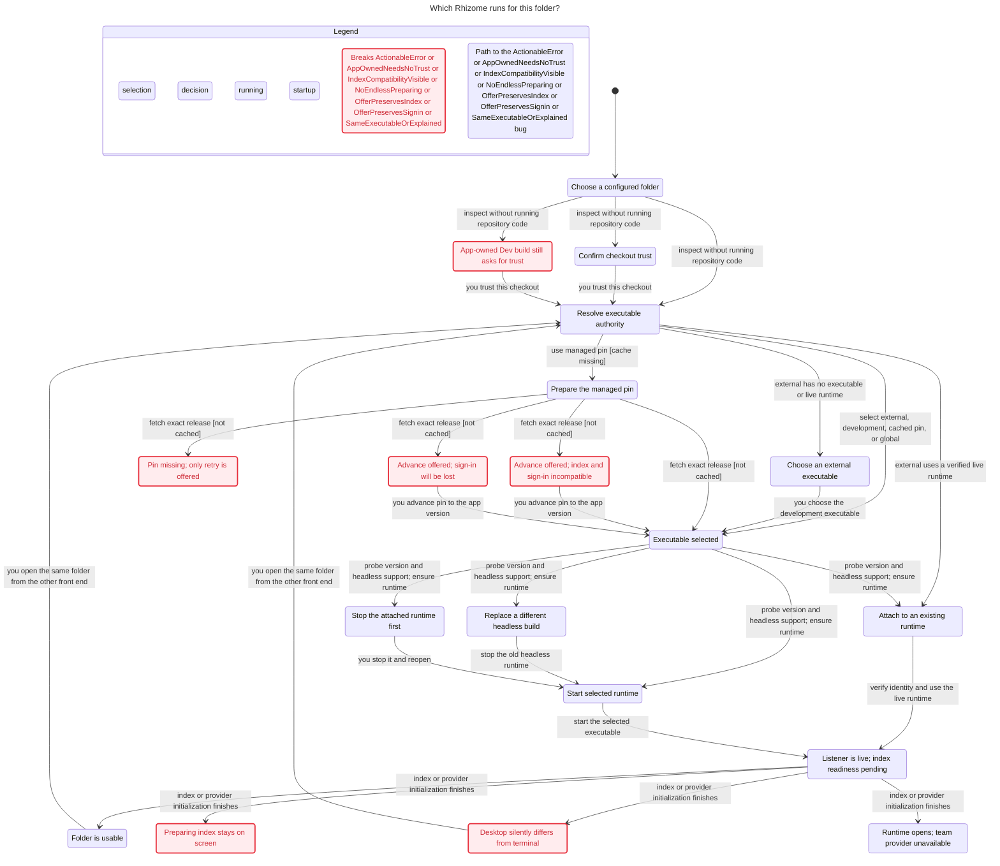

# Executable selection statechart, 2026-11-08

## Conclusion

The terminal and the desktop app share one precedence planner, `repoexec.SelectWithEnv` (external manager, configured development build, source-checkout development build or Rhizome Dev app, managed pin, global). That planner stops at an *authority*. Each front end then completes the exact executable on its own, `runtime.Ensure` separately decides whether to attach to or replace a live runtime, and nothing checks that the chosen executable can serve this folder. Version ordering says nothing about index schema or platform capabilities, and a live listener says nothing about a usable index.

A TLA+ model of that flow (217 states, 235 steps) breaks seven of eight rules across five paths. Every path was replayed against the code at `3a108b21` and reproduces. Repository-selected code never runs before trust in any modeled path.

## Resolution

All five paths are fixed on `fix/desktop-unpublished-pin`, after `584d89bd`:

- P5: a failed startup index (other than one displaced by explicit indexing) is recorded on the web runtime; status adds `indexError`, and the banner shows "Index unavailable" with the cause instead of "Preparing index…".
- P2: the bundled build checks the existing index's Intel schema read-only (`store.CheckReadable`) before offering a pin advance. An index from a newer Rhizome makes the offer `incompatible`, which pin advance refuses; an executable the app cannot check is offered with a `caution`. The bundled build has a credential store on every desktop platform, so sign-in carries over.
- P3: a missing pin with no advance leads with Check for App Updates and offers Choose executable. A per-worktree executable runs for a managed worktree only once its pin's release is known to be missing, without a build-identity check, since it may be a shim.
- P4: runtime status carries the manifest's executable, and an external worktree's "External rzm" toolbar item names the running `rzm`, explains the app's global fallback, and offers Choose Executable.
- P1: desktop needs no trust to run the Dev app's `rzm` in a pinned source checkout. CLI dispatch keeps trust there, because `init` and `update` act on the pin.

The shared execution result (recommendation 5) was not built.

## Incidents that motivated it

On one Linux arm64 machine, folder `agentic-process`:

1. The folder used `binaryManager: external` to run a local dev build. Desktop refused to open it with no live runtime and no chosen executable. Fixed in `7361ed57`: desktop now falls back to its own executable.
2. The committed pin `v0.48.0` had no published release (404). Fixed in `929f53b3`: `pinned_version_unavailable` and an offer to advance the pin.
3. Advancing to the app's `v0.51.0` opened a runtime that could not read the index the dev build had written (Intel schema 80, supported 78). The UI showed "Preparing index…" indefinitely.
4. `v0.51.0` has no Linux credential store (Secret Service landed later in `2d432b56`), so team sign-in and semantic search were unavailable, while the dev build in the same folder was signed in.

## Findings

| Path | Broken rule | What happens | Replay evidence |
| --- | --- | --- | --- |
| P5 | `NoEndlessPreparing`, `IndexCompatibilityVisible` | An executable that cannot read the index leaves "Preparing index…" up forever. | `desktop/open.go` never checks readiness or compatibility; `cli/serve/readiness.go` marks ready only on index success; `readiness_poll.go` keeps polling; `IndexReadyBanner.tsx` has no error branch. Replay tests `TestStatechartOpenAcceptsIndexNotReady`, `TestStatechartFutureSchemaLeavesReadinessClosed`. |
| P2 | `OfferPreservesIndex`, `OfferPreservesSignin` | The pin offer compares version strings only, so it offered `v0.51.0`, which cannot read the index and lacks Linux sign-in. | `desktop/pin_offer.go` (`pinOffer`) uses `CompareVersions` only; the updater smoke test runs `--version` only. `v0.51.0` source: schema 78, `store_other.go` returns `ErrStoreUnavailable` on Linux. Replay `TestStatechartOfferUsesOnlyVersions`. |
| P3 | `ActionableError` | An unpublished pin equal to or newer than the app gets only "Try again", which repeats the same 404. | `pinOffer` gives no offer for equal and `app-older` for newer; `PinAdvance` rejects both; `Status.tsx` then offers retry only. Replay `TestStatechartMissingPinNoRecovery`. |
| P4 | `SameExecutableOrExplained` | For an external folder with no live runtime or saved choice, desktop runs its own `rzm` while the terminal runs whatever was invoked, without saying so. | `desktop/open.go` falls back to `globalExecutable`, which prefers the app-owned binary (`global.go`). Intentional since `7361ed57`; the gap is the missing explanation. Replay `TestStatechartExternalDifferentExecutable`. |
| P1 | `AppOwnedNeedsNoTrust` | A Rhizome source checkout that pins a version still asks for trust when it would run the Rhizome Dev app's own build. | `repoexec/plan.go` `TrustRoot` exempts the Dev app only without a pin; `repoexec/trust.go` preserves that deliberately. **Policy decision pending with Drew**; keep current behavior until decided. Replay `TestStatechartDevAppPinStillRequiresTrust`. |

`TrustBeforeRepoCode` holds. `NoDeadlock` holds only because terminal states stutter; it does not prove useful recovery.

## Where authority is split

| Boundary | Current authority |
| --- | --- |
| Shell and native host | The shell chooses the first invoked `rzm`; the app starts its bundled bridge. |
| CLI dispatch | Adds command exceptions, already-selected identity, marker bootstrap, interactive trust, and handoff. `update`, `trust`, `auth`, `desktop`, and `init --binary-manager external` stay on the invoking executable. |
| Desktop Open | Inspect uses a placeholder fallback; `prepare` later resolves per-worktree or global choices; external live-runtime attach precedes preparation; Open probes `serve --headless`. |
| Updater | `ResolveInvocation` and `BuildUpdatePlan` decide mutation targets; `EnsurePinnedBinary` trusts cached binary markers; pin offers add version-only eligibility. |
| Runtime | `Ensure` decides the live process: a build mismatch replaces a headless runtime and refuses an attached one; a blank build ID disables the comparison (external). |
| Readiness and providers | Index schema and credential-store support decide usability only after selection has already succeeded. |

## Design options

| Option | Benefit | Cost |
| --- | --- | --- |
| Terminal readiness errors with recovery actions | Ends endless "Preparing index…"; gives every missing pin a route. | Diagnoses an unsuitable selection after the fact. |
| Compatibility gating on a descriptor (index schema bounds, required platform and provider capabilities) | Prevents offers and starts that lose index access or sign-in. | Descriptor must evolve; older binaries report "unknown"; probing a candidate needs the existing trust boundary. |
| One shared execution result from `repoexec` | Both front ends receive the exact target, the reason, the trust requirement, version and build, compatibility, and the disposition of any live runtime. Separates the desired executable from the attached runtime. | Moves caller-specific completion into one place; shell and GUI environments can still differ intentionally. |
| Explicit external behavior in the app | Prefer a verified runtime, then a saved executable, then a visible app fallback naming its path, version, and reason. | Some managers still need a one-time choice; a shim may not reveal a stable build identity. |

## Recommendation

1. Deliver terminal readiness errors first (P5), with actions: use a newer Rhizome, choose an executable, or rebuild the index on explicit request. Never rebuild automatically to fit a preferred binary.
2. Gate pin offers on index schema compatibility (P2). Desktop can read the index's schema version read-only and compare it with the target build's supported range; treat unknown as "explain", not "compatible". Sign-in capability can join the same descriptor.
3. Give unpublished pins at or above the app's version a real way out (P3): check for app updates or choose an executable.
4. Show which `rzm` desktop runs and why (P4), especially the external app fallback.
5. Complete the shared execution result under `repoexec` so the CLI and desktop consume one decision, including compatibility and live-runtime disposition.
6. P1 waits on Drew's decision.

## Model scope

The model omits command grammar, bypass variables and direct invocation, dotenv, invalid configuration, path and symlink races, download and checksum failures, install-lock and election interleavings, crashes, runtime identity attacks, cancellation timing, multi-window persistence, and real authentication transport. It is a finite scenario model, not a concurrency or security proof. The chart merges marker reads, artifact substeps, trust-store I/O, health polling, individual index phases, and provider construction; 40 steps stay within one chart label and none were explicitly hidden.

## Chart

## Files

Beside this note in `executable-selection-statechart/`:

- `Selection.tla`, `Selection.cfg`: the TLA+ spec and TLC configuration.
- `view.mjs`: chart labels, phases, and step wording.
- `chart.mmd`, `chart.svg`: the generated chart.
- `tlc-report.txt`, `tlc.out.txt`: the generated report with numbered bug paths, and TLC's output.
- `replay/*.go.txt`: the replay tests, kept as text so they do not compile into the module. Copy one into its package as `*_test.go` to rerun it.
- `regenerate.sh`: `STATECHART=<t3-pstack statechart script> ./regenerate.sh <new output directory>`. Exit status 1 is expected while rules break.

Model and replay by GPT-6.1 Sol (xhigh) through the t3-pstack statechart skill; reviewed and summarized by Claude Opus 5.5.
