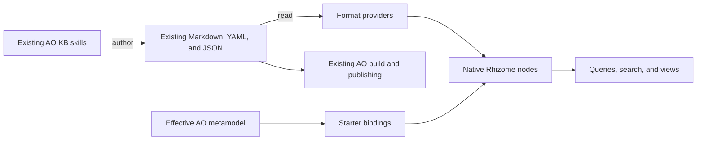

# Format-neutral embedded nodes and AO KB adoption

## Summary

The first milestone lets someone enable a Rhizome starter in an existing AO KB repository and use Rhizome to browse, query, search, and connect its knowledge and product model. Setup consists of installing the starter, generating bindings for a selected product, and indexing the selected sources. The existing AO KB skills continue to own ingestion, curation, model changes, artifact generation, and publishing. Both tools use the same authored files.

Rhizome supplies a common embedded-node model that accepts structure from Markdown and structured-data providers. An AO KB starter translates the repository's effective metamodel into bindings for that model. It uses the existing starter installation and update machinery. It does not maintain another editable copy of the knowledge base.

On 2026-11-06 Drew accepted this side-by-side adoption direction and requested a detailed plan before implementation. He then requested a council review with Fable, Opus, and Sol, plus collaboratively reviewed design comps that demonstrate custom knowledge/assertion views, visualizations, and link navigation. These experiences are part of the first milestone. After the council finished satisfied, Drew approved the plan and started implementation on 2026-11-06 under [[docs/efforts/2026-11-06-17-07-ao-kb-adoption|EFF-2026-11-06-17-07]].

## Goals

- Make embedded identity, containment, typed fields, relations, and reads independent of Markdown syntax.
- Preserve current Markdown identities, queries, rendering, and edits, and preserve HTML's root-only behavior.
- Read the existing AO KB knowledge and product model without rewriting authored content or disrupting existing commands.
- Provide custom knowledge and assertion views, focused relationship visualizations, and saved queries over the same records that AO KB uses.
- Make unsupported input, ambiguous identity, stale bindings, and unavailable calculated values explicit.
- Establish reusable platform contracts so later AO KB workflow ports can use native actions and tasks.

## Non-Goals

- Porting evidence weighting, contradiction resolution, curation, or artifact write-back in this milestone.
- Creating, editing, reordering, moving, or deleting YAML/JSON records through Rhizome.
- Making provenance-sensitive AO KB fields editable through the generic property editor.
- Rebuilding the definition-site, prototype, or publication engine, or changing its audience rules.
- Adding an external package manager, a provider plugin SDK, a general expression language, or a new scheduler.
- Migrating authored YAML to Markdown or maintaining generated Markdown copies of YAML records.
- Automatically creating evidence or links from inferred similarities.

## Existing constraints and evidence

This plan was prepared against Rhizome `e8d910cb5` and AO prompt toolkit `e9dce951` (AO KB 7.138.8; kb-site 3.137.0). These revisions identify the inspected baseline, not a promise to support every historical or future AO KB version.

| Boundary | Current constraint | Planned change |
| --- | --- | --- |
| Provider projection | `pkg/noteformat/facts.go` has root facts but no common structural-owner collection. | Extend the existing facts envelope with validated, schema-free structure. |
| Structural dispatch | `pkg/ontology/projection_source.go` uses structural mutation capability to select Markdown parsing. | Separate structural reading from writing and dispatch by executable provider support. |
| Schema | Embedded types must implement `Section`; their fields default to inline Markdown properties. | Separate embedded role from source shape; retain the current defaults for Markdown. |
| Catalog and hydration | Catalog traversal, `noderead`, workspace bodies, and links consult Markdown snapshots. | Consume shared structure; keep prose rendering and Markdown edits in their adapter. |
| Editing capability | `node_field_capability.go` derives editability from field source, while `@policy` describes guidance. | Enforce the selected read-only source binding in shared mutation admission and capability reporting. |
| Installation | Init already installs modules, scripts, actions, tasks, views, guidance, and hooks and preserves local edits. | Add an ordinary starter; reuse ownership, upgrade, and hook behavior. |
| AO compatibility | The effective metamodel defines selectors, identities, relationships, and project overrides. | Translate that resolved model rather than hardcoding filenames or kinds. |
| Knowledge fields | Current `projection_values.go` looks up flat frontmatter keys; it does not traverse nested provenance paths. | Add bounded owner-local path traversal for the early knowledge slice, preserving existing literal-key behavior. |

Governing contracts: [[structural-node-model-and-ontology-read-path]], [[note-format-provider-registry]], [[note-node-indexing-architecture]], [[non-section-embedded-node-source-shapes]], [[linkable-embedded-node-identifiers]], [[node-workspace-capability-pipeline]], [[ontology-indexed-read-model-contract]], [[ontology-edit-replay-conflict-contract]], [[format-aware-root-ontology-projection]], and [[init-starter-workflow]].

AO source evidence is in `packages/kb-site/kb_site/kits/core/_build/metamodel.py`, `standard-metamodel.yaml`, `account.py`, and their tests; authoring conventions are in `plugins/ao-kb/references/templates/.kb/system/kb-conventions.md`. The existing build/export behavior remains owned by that toolkit.

## Requirements

### R1. One structural model

Providers MUST emit immutable, schema-free structural facts through the existing `noteformat` boundary. Each owner carries a source-local key, its parent and collection membership, deterministic source order, source shape/address, optional exact byte ranges, property occurrences, and authored locator evidence. Ranges refer to original bytes, including Unicode, BOM, and line-ending differences.

Ontology MUST remain the owner of type matching, field interpretation, canonical `NodeRef`, identifier uniqueness, link resolution, validation, and catalog/field rows. No provider may recognize AO type names or import ontology schema logic. Ordinary syntax containers MUST NOT all become graph nodes; bindings select the meaningful records.

Structural read support and supported mutations MUST be separate capabilities. A provider with readable children and no edit planner MUST remain fully queryable. Declaring a capability without executable support MUST NOT select a different format's parser.

The Markdown adapter MUST preserve current structural-only sections, marked and markerless list items, checkboxes, nested ownership, and existing identity behavior. HTML MUST remain root-only. The shared structure MUST NOT require a heading level, inline-property spelling, caret anchor, or Markdown body.

### R2. Explicit structured-data bindings

YAML ownership MUST be explicitly selected through configured source paths. Adding the provider MUST NOT claim every YAML file in a repository. Generated JSON referenced by a supported AO metamodel MUST be readable through the same structured-data contract; it remains read-only. Both use the existing source-discovery and single-writer publication path.

The bounded collection selector vocabulary MUST cover named/dotted paths, list expansion, mapping-value expansion, and mapping-to-list expansion used by AO KB: `rows`, `rows[]`, `rows{}`, and `groups{}[]`. It MUST support nested collections and scalar string/integer rows where the metamodel permits them. This is not arbitrary JSONPath or executable schema expressions.

Bindings MUST describe source selection, owner-local fields, identifier evidence, title selection, containment, and references independently of provider syntax. Proposed SDL/model spelling will be reviewed in the foundation batch before consumer migration. Existing Markdown declarations keep their semantics.

Authored values MUST preserve list order and repeated values independently of graph edges. Missing, null, empty string, and empty collection MUST remain distinguishable in the source-value representation. Mappings, nested values, and unbound properties MUST remain inspectable as source content even when no typed scalar field represents them. The first version need not provide arbitrary-object filtering or editing.

Parse semantics MUST be tested against the pinned AO reader, including quoted/unquoted IDs, numeric values, dates, and boolean-like words. Unsupported tags, aliases, merge keys, duplicate mapping keys, complex keys, or multiple documents MUST yield specific diagnostics or a proven faithful read result. No silent flattening, coercion, or partial-success claim is allowed.

### R3. Identity, containment, and links

Canonical physical source identity, AO logical identity, source position, and external locator MUST remain distinct. Reordering keyed records MUST preserve their canonical identity. Identity MUST support explicit fields, mapping keys, and the bounded composite-key templates present in the effective metamodel without case folding or slug conversion.

AO's `key: null` positional identities MUST retain their existing meaning. They are unstable across insertion or reorder. Such records MUST be labeled as positional, and a locator MUST either be revision-bound and reject stale resolution or be explicitly unavailable as a durable link. A reused position MUST NOT silently retarget a previously captured reference.

AO uniqueness is scoped by effective product and kind. A child's explicit AO ID is not automatically prefixed with its parent's ID. Account records visible in more than one product MUST retain one physical source identity while participating in the appropriate product contexts. Ambiguous IDs MUST retain source locations for diagnostics and MUST NOT choose an arbitrary record.

Account/product data MUST be compared with AO's effective-document merge, not just concatenated source inventories. AO concatenates sequence values account-first, recursively merges mappings, and prefers a present product scalar when values conflict. For this first milestone, every projected record and its field values must be attributable to one physical source record. Separate account/product rows and account-first positional numbering are supported; a row assembled from overlapping mappings in both files is an explicit unsupported compatibility case. Report the affected kind, key, and both source paths, and mark model setup incomplete instead of emitting a plausible partial record. Supporting such mixed-origin rows later requires per-value contributing-source provenance, not a fabricated single locator. Fixtures MUST include mapping overlap, scalar override, and account-first positional numbering.

Nested containment MUST remain separate from semantic relationships. Authored strict references, tolerant text references, ordered/repeated references, and typed references MUST follow the metamodel's meaning. A declaration that validates a reference without creating an edge MUST remain distinct from an edge declaration. Markdown evidence links and generated JSON targets MUST resolve through the same node read model.

Source navigation and copy-link behavior MUST use provider-backed locators. YAML nodes MUST never acquire Markdown caret anchors or fabricated heading levels. Existing Markdown locators MUST continue to resolve unchanged.

### R4. Complete read behavior and freshness

The same canonical record MUST be available through catalog listings, typed GraphQL queries, node reads, relation traversal, standard views, and configured search. Rich selections such as content, children, and workspace MUST work as well as summary selections. Generic records display fields, child collections, and native source content without pretending their source is Markdown prose.

Searchable content and links MUST be attributed to the correct owner. Ancestor context must remain bounded; siblings MUST NOT all inherit each other's evidence. Existing Markdown display titles and embedding inputs MUST retain their distinct contracts.

One operation MUST reuse its source capture, provider parse, and resolver per host file. Full indexing, incremental changes, deletes, schema/binding changes, provider-version changes, and restart MUST converge to the same records and edges. Publication remains atomic through the existing index writer. Any materialization change MUST invalidate the appropriate derived state.

When AO tools change authored files, ordinary Rhizome refresh MUST update the records. When their effective metamodel or product configuration changes, the binding artifact MUST be detected as stale. Old bindings MUST NOT silently be presented as a current interpretation.

### R5. AO KB retains write ownership

The starter's AO-managed record bindings MUST be read-only in this milestone, including Markdown claims and artifacts. Shared server-side admission MUST refuse native field, body, collection, identifier, and graph-maintenance writes that would alter those records; the UI MUST advertise the same capability and a useful reason. Advisory `@policy` text is insufficient. Unrelated Markdown records retain normal editing.

Read-only source ownership MUST be recorded independently of successful type or record projection. Setup establishes the AO-owned source paths before publishing bindings; malformed notes, missing types, failed initial compilation, and stale or invalid bindings MUST NOT turn owned files into editable fallback notes. Retain the last established ownership through failed refreshes. Admission MUST check current ownership at commit as well as staging, including graph-safe operations whose affected files extend beyond their initial target. A previously staged edit cannot bypass a later ownership restriction. The ownership set covers known AO-authored sources even when their product is not selected for typed projection; it does not include unrelated repository notes. Removing this protection requires explicit removal/ejection handling, not a failed parse.

This is an application mutation boundary, not a filesystem permission system. AO skills and an explicitly chosen external editor can still change the source files. Rhizome MUST not claim those external writes have passed AO validation.

The common read refactor MUST preserve existing Markdown edit planning, draft overlays, conflict detection, and source transactions. YAML/JSON writes, their draft overlays, and generalized structural edit APIs are deferred. No stub edit API should promise future support.

### R6. A thin starter using existing infrastructure

The starter MUST discover the selected AO KB root and its effective product model. For an initial bounded release, the proposal is one explicitly selected product context per Rhizome vault, including its visible account records. It MUST recognize a multi-product repository and require/select that context explicitly instead of merging unrelated identities. Simultaneous browsing of all product contexts is a separate scope decision.

Product selection scopes AO typed projections, logical reference resolution, and starter recipes. It is not an access-control or whole-vault search boundary. Existing ordinary Markdown/fallback reads and source search may show files from other products, but MUST NOT label those results as members of the selected AO model or let their colliding aliases/IDs win AO reference resolution. Test an unselected product containing the same claim and model identifiers. Preserve existing note include rules rather than silently hiding repository content.

A starter-owned binding compiler MUST reuse AO's effective-metamodel resolution where available. It produces deterministic, disposable Rhizome bindings and records the relevant toolkit version, product selection, source configuration fingerprints, and compiler version. It MUST not invoke AO ingestion, curation, generation, or publishing merely to discover a schema. The implementation must first inspect the existing metamodel command; if it omits required information, use a narrow adapter around the pinned AO library rather than duplicate its merge semantics.

The compiler MUST stage and validate a complete binding set before publishing it. Failure retains the previous set with an explicit stale/error state. A dependency/version check action and a refresh-bindings action are enough initially; do not add a background agent for deterministic work. Exact behavior for an installed starter whose bindings require refresh is an acceptance case.

Current init installs static starter assets and does not execute a project-specific compiler. The starter's setup skill MUST therefore orchestrate the explicit sequence: normal `rzm init` starter installation, dependency/root/product preflight, source-ownership registration and binding refresh, then normal indexing. Direct CLI users receive the same documented sequence. Distinguish "starter installed", "bindings ready", and "index ready" in the setup report. `init --check` certifies managed files only; the starter check action certifies binding freshness and prerequisites. Neither one alone certifies a usable AO projection. This milestone adds no generic post-install execution hook.

Knowledge bindings MUST cover sources, assertions/claims, concepts, artifacts, the durable `.kb/curation/_conflicts.md` registry, and authored evidence/supersession relations. Model bindings MUST come from the effective metamodel, including project overrides. Calculated AO judgments such as confidence bands or derived horizons MUST be sourced with freshness evidence from existing AO outputs, or clearly marked unavailable. They MUST NOT be reimplemented or guessed for this milestone.

The product metamodel's assertion kind has no field definitions, so the starter MUST also provide a versioned knowledge-convention adapter. The following semantic mapping is part of its contract; final SDL names may follow repository conventions, but meaning and direction are fixed:

| Authored AO location | Native field or relationship | Direction and unsupported behavior |
| --- | --- | --- |
| Assertion `id`, `headline`, body before its structured sections | Logical identifier, display headline, complete assertion text | Preserve headline/body distinction; never label the assertion body as a source quotation. Missing optional headline falls back through the documented AO rule. |
| Assertion `confidence`, `kind`, `attestation`, validity dates, status, `horizon`, `priority`, `sensitivity` | Separate stored fields | Preserve unknown/missing values; do not synthesize a verdict or effective currentness from one field. Horizon and priority remain separate. AO attestation defaults may be shown only as labeled defaults, not stored facts. |
| Nested `provenance.speaker`, `provenance.speaker_role`, extraction metadata | Recorded attribution and extraction fields | Use owner-local nested-property paths. Missing recorded role is not inferred from a person's name or source title. |
| Assertion `## Sources` links; declared provenance relationship to a source | Evidence-source relationship with authored locator | Assertion to source. Preserve document-only versus passage-specific citation and source order. `provenance.source` identifies the origin when recorded; otherwise AO uses the first Sources link. Incidental prose links outside this binding are not evidence. |
| Assertion `corroborated-by::` links | Corroborating-source relationship | Assertion to source, distinct from origin and extraction; external/generated corroboration does not change the recorded speaker's origin. |
| `## Connections` typed links and frontmatter `connections` | Typed supports, contradicts, supersedes, resolves, and other declared relations | Follow AO's canonical relation vocabulary and inverse aliases, retain same-type edges, deduplicate duplicate declarations, and diagnose unknown/unresolved declarations. |
| Source `extractedAssertionIds` | Extraction relationship | Source to assertion; do not silently equate extraction with corroboration. |
| Assertion `contradicts_rows` and `supports_rows` | Recorded demo-feedback references | Preserve the authored kind/ID values as inspectable source fields in this milestone; do not confuse them with claim-to-claim contradiction or support. Typed traversal and curation of these fields are deferred, not unknown syntax. |
| Concept `## Related Concepts` | Related-concept relationship | Concept to concept; do not reinterpret as support. |
| Artifact body references | Artifact references relationship | Artifact to referenced record; derived reverse impact is labeled as navigation, not a new evidence claim. |
| `.kb/curation/_conflicts.md` entries | Read-only conflict records linked to both assertions | Display AO's recorded State, Winner, Rule, Resolution, overrides, and Updated with their provenance. The registry mixes generated fields with human decisions; preserve it as durable source, not a disposable cache. Recorded impact/dependents are AO results, not Rhizome calculations. |
| Product-model field declarations and references | Model fields and typed edges | Follow effective metamodel direction and strict/tolerant semantics; a checked reference without an edge declaration does not create an edge. |

The adapter MUST cover AO's documented frontmatter connection shapes and relation aliases at the supported baseline. This is deterministic syntax/convention translation, not a port of AO truth or curation algorithms. Unknown conventions produce compatibility diagnostics. Record, typed query, and focused graph MUST agree on the translated relationships for the same fixture.

Existing AO weights output may supply an explicitly labeled saved assessment. Show its band and basis verbatim with available `asOf`, `generatedAt`, and builder metadata. Do not label it current: its time-dependent meaning applies to the recorded assessment date. A known later input change adds a `may be stale` indication; absence of that evidence does not prove freshness. Missing output is `unavailable`. Saved analysis never overrides separately displayed stored confidence and recorded attribution. The generated `_check_first.md` may be displayed as an AO report with its recorded date; do not recreate its ranking.

Stored `sensitivity` is descriptive metadata in these views. This starter establishes no audience ceiling or new export authorization. Existing AO publishing rules continue to govern AO publication; Rhizome access uses its existing access controls.

The starter MUST reuse init's managed-file ownership, dependency resolution, update, check, and ejection behavior. It MUST preserve existing AO configuration, skills, commands, authored notes, and customizations. Repeated initialization MUST be idempotent. New format includes MUST be restricted to the selected model/evidence sources and preserve unrelated include rules.

Use existing collection, record, graph, and view APIs as the foundation for the custom experiences in R7. Ship bounded saved queries for model-to-evidence navigation, claim-to-source navigation, and reverse impact through authored edges. Scheduled checks and extra hooks remain outside this milestone unless they are necessary for a stated acceptance criterion.

### R7. A useful knowledge and assertion workspace

The first milestone MUST include a designed experience that demonstrates the value of the connected knowledge, beyond exposing raw collections. The following are user jobs, not a requirement to create three independent application shells:

- **Understand what needs attention.** Browse and filter assertions, inspect authored unresolved/conflicting/superseded state and evidence coverage, and open the affected knowledge without maintaining a separate task list. Distinguish authored AO status from structural observations Rhizome can prove. Missing analysis is not a healthy result.
- **Inspect an assertion and its evidence.** Read the complete claim in context, open its supporting or conflicting source at the granularity actually recorded, inspect attribution and recorded dates, distinguish direct evidence from inference where AO stores that distinction, and follow supersession history without merging these facts into an invented confidence score.
- **Navigate the links and consequences.** Move from a source to its assertions, through concepts or product-model records, to affected artifacts or authored code references. A focused graph or structured trace MUST expose edge meaning, direction, and selected-node context. Expansion must be deliberate and counted; dense graphs MUST NOT silently truncate or present every neighbor as equally relevant.

The views MUST use native node identity, source locators, shared query results, and the existing navigation stack so list, record, and graph interactions agree. Preserve user context and provide a clear return path when following evidence or impact links. Do not require a custom graph to perform an operation already supported well by the existing graph components.

Deliver one Knowledge workspace with Attention, Concepts, Assertions, and Trace presentations, plus assertion, source, and model-record presentations in the existing reader. Preserve the active presentation, concept/filter text, sort, trace focus, depth, and explicit expansions in supported navigation state. These names describe the reviewed experience, not a new application shell. Conflict entries have stable native identity and can be opened at their source section; showing the entry with both assertions in the assertion reader is sufficient without another dedicated conflict dashboard.

Trace is relationship navigation, not a prediction of causal impact. Arrows always keep their authored direction. The following traversal classification is separate from the edge's name and storage direction:

| Authored relationship | Upstream navigation | Downstream navigation |
| --- | --- | --- |
| Assertion cites/corroborated by source; model/artifact evidenced/supported by assertion; artifact references record | Follow outgoing reference to its target | Follow incoming reference to the citing record |
| Feature serves flow; flow served by screen; screen made of component; requirement governs flow | Follow incoming declared structural relation | Follow outgoing declared structural relation |
| Assertion contradicts/supersedes/resolves/refines assertion; concept mentions/related concepts | Show as related beside the focus | Show as related beside the focus, preserving actual direction; do not recursively infer impact |
| Source extracted assertion | Show separately as extraction history | Do not equate extraction with evidential support or repeat an existing citation edge |

Traverse only declared relationship kinds in this table or explicit additions from a compatible binding. Unclassified custom relationships remain visible in the relationship list without guessed upstream/downstream meaning. Use cycle-safe traversal and explicit depth/node limits on both sides; a UI affordance named All still has a documented query budget and must disclose an incomplete result. Count unique nodes reached and relationships traversed within the selected depths, including the defined lateral relations of the focus. Links between visible boundary records that require another hop are outside that count; say so in the view. Distinguish a display cap from an incomplete query. The list and graph must agree on their scope. At narrow widths a structured relationship list may replace crossed graph edges. Pin forward, reverse, lateral, cycle, and truncated cases in one fixture.

AO `component.implements` and `pattern.implements` are recorded text paths, not declared model edges. Show them as `Referenced code paths` on the record. Resolve an exact path only within the already configured repository/code roots using existing file navigation; a missing file says `Not available in this repository`. Do not search another product or machine, infer a symbol by basename, or manufacture a semantic edge. A path-only affordance is excluded from Trace edge/hop counts. Existing explicitly authored code relations may appear normally. The first milestone promises code-path navigation when the file is available, not code-impact analysis.

Concept coverage uses one clearly labeled unit: the origin citation of each assertion that links that concept, selected by the R6 precedence rule. Concept membership comes from links, not an invented primary-concept field. Use the same membership set in concept rows, records, and filters; a claim can appear in several concept rows, while overall legend totals count each claim once. The mutually exclusive categories are resolved recorded passage, supported source with unsupported locator, document only, unresolved source/locator, or no source. Additional citations and corroboration remain visible on the assertion and do not inflate this chart. This measures locator coverage, not truth or evidential strength. AO rollups and `unmodelled` results may only be displayed as dated AO output.

The initial attention filters are bounded structural observations: an incoming authored `supersedes` edge, expired recorded `validUntil`, recorded archived status, a question with no incoming `resolves` or `supersedes` edge and no retracted status, no Sources link, a dangling declared reference, or an authored contradiction pair. Each filter MUST name its reason. A contradiction edge alone means `contradiction recorded`, not an unresolved dispute; when present, show the conflict registry's recorded state alongside it. A cited assertion whose recorded `updatedAt` is later than model `synced` or artifact `graphSyncedAt` may be marked `knowledge updated since sync`; absent or incomparable dates mean unknown. No new effective-origin, confidence-band, blocking/sideline, or importance-ranking algorithm belongs in the view. Pin these observations and their missing-data behavior in fixtures.

Model `synced` belongs to the source file. Group that observation by file, name the affected rows and changed citations, and offer those exact rows for navigation; do not route a file-level warning to an arbitrary first row. Recorded `validFrom` is a validity date, not proof of when a question was asked. Labels must describe the actual date being shown.

Citation presentation MUST distinguish an authored precise passage locator, a source-document link without a passage locator, and an unresolved source. Show an excerpt only when the recorded locator resolves, label it `Recorded passage`, and separately report whether a recorded quote hash was verified. Document-only links say "No passage locator recorded" and open the document. An embedded record's own byte range does not establish the location of its evidence. The design and acceptance journey MUST include all three cases.

AO locators resolve against the source's ordered `path` entries, commonly archived `.md`/`.txt` files under `sources/_raw/`, with the source-note body as the documented fallback when no eligible local text exists. An explicit `N::span`, path, or unique-basename selector retains its original list slot and never falls through to another file. The knowledge adapter MUST follow the pinned `locators.py` selection rules. Read referenced local raw text on demand through normal authorized file access; do not index all raw files or create additional evidence nodes just to display a passage. Reject paths outside the authorized roots rather than widening access from a source entry.

The initial passage reader supports line and section spans with parity fixtures against AO's resolver. Timestamp spans and `view:`/`review:` locators remain visible but explicitly unsupported for inline passage display until their own parity cases pass; users can open the recorded source. Quote/source hash checking is deferred, so display `Passage hash not verified by Rhizome` where relevant and make no verified-quotation or drift claim. A malformed or unresolved locator remains a visible diagnostic and MUST NOT silently become an exact excerpt from the source note.

Use the public view kit (`useViewRows`, `useGraphQL`, `NodeLink`/`openNode`) and the existing `Diagram` component where suitable. Bundled cross-type Trace skips same-type links and cannot alone represent assertion history; explicit assertion relations remain required. Put meaningful selection, lens, and filter state in the supported URL/navigation contract, with durable display choices in view preferences. Verify direct links and browser Back/Forward as well as local selection. List alternatives accompany the visualization, with edge direction, hop meaning, and omitted/expanded counts available without color or hover alone.

Keep read-only authoring boundaries clear without filling the interface with implementation details. A source-opening or AO workflow handoff must be honest about what it does. Do not show a successful resolve, accept, edit, or publish operation that this milestone cannot execute. Design comps may use synthetic data and local interactions; they MUST identify the data as illustrative and must not imply a working live integration.

Comps MUST cover a realistic assertion-review journey, useful knowledge browsing, and focused relationship navigation within Rhizome's existing visual language. Include empty, missing-evidence, unresolved-reference, stale-analysis, and dense-link behavior in the design/acceptance notes. Keyboard access, readable labels, light/dark appearance, and desktop working widths remain part of the contract.

Opus owns the initial design comps. Fable and Sol independently critique the proposed experience and plan; the coordinator integrates their concrete objections and sends updated comps and plan through a fresh review. Iterate to reasonable agreement on usefulness, evidence fidelity, navigation clarity, feasible scope, and visual quality before showing the recommended comps to Drew. The comps do not authorize feature implementation.

## Proposed delivery plan

This sequencing is for review. The first implementation step after plan approval is to open an effort and freeze the selected requirements, baseline, and exact plan revision. Each batch carries its focused tests and documentation. Only the foundation exit calls for an early independent review; routine later corrections remain within the approved scope. Develop the knowledge-view fixtures and comps alongside the foundation, and deliver the usable Markdown knowledge slice before the YAML model work. The whole milestone still includes both.

### Batch 1. Freeze contracts and prove Markdown parity

**Outcome:** a common structural read contract supports Markdown and a synthetic non-Markdown provider without changing existing behavior. Advances R1, R3, R4, and R5.

**Ownership:** `pkg/noteformat`, `pkg/ontology/schema`, shared projection/catalog types, and their contract tests. Keep the current Markdown parser and mutation implementation.

**Work:** capture expected Markdown identities, containment, selected fields, links, display titles, and embedding inputs for existing fixtures; define and validate structural owners; separate read capability from mutation; specify the bounded source-binding and read-only admission contracts; migrate the Markdown adapter. Test a synthetic provider that has children but no mutation capability. No AO-specific branches enter core code.

**Exit evidence:** contract tests reject duplicate local keys, missing parents, cycles, invalid ranges, and unsupported capability declarations. Matched Markdown fixtures produce equivalent public records and edit results. A synthetic child's summary and rich read both work without the Markdown parser. An independent foundation review accepts the data model, binding semantics, locator strategy, and ownership boundaries before dependent work.

**Escalation:** a required breaking change to existing Markdown identities or authoring declarations, or an unbounded selector language, changes scope and requires review. Routine internal type/filename choices do not.

### Batch 2. Deliver the Markdown knowledge and assertion workspace

**Outcome:** existing AO sources, assertions, concepts, artifacts, and conflict records are useful through the reviewed R7 experience before YAML is available. Advances R5 through R7 and supplies real parity fixtures for the common model.

**Ownership:** canonical AO starter assets, the knowledge-convention adapter, custom views, and the narrow shared read/admission support they demonstrably require. Model bindings remain in Batch 4.

**Work:** install static knowledge types and recipes through ordinary init; establish AO source ownership; read nested provenance, ordered Sources links, corroboration, typed connections, and conflict entries; implement the counted relationship journey and line/section passage reader. Add bounded owner-local property traversal to the common read path with a parity fixture and unambiguous literal-key compatibility; do not flatten or rewrite authored metadata or introduce an independent view parser. Complete the server-side read-only enforcement needed for these records before exposing the slice. Model hops display an explicit unavailable state until Batch 4.

**Exit evidence:** a disposable Markdown-only AO fixture supports assertion discovery, the three evidence states, history, conflict explanations, and source-to-assertion-to-concept/artifact navigation. Keyboard, direct-link, Back/Forward, and dense-neighborhood checks pass. Compare knowledge nodes/edges with AO's `.kb/index/kb-index.json` and line/section results with its pinned `locators.py`. Unsupported locator schemes and absent/stale saved analysis remain explicit. Ownership refusal covers malformed/fallback notes and staged edits, not merely editable-looking fields.

**Escalation:** if the slice requires a broad parser or navigation redesign beyond the approved foundation, surface the concrete deficiency before adding it. Do not make early knowledge value wait for product-model support without explaining that dependency.

### Batch 3. Read structured records through every shared surface

**Outcome:** YAML and referenced generated JSON records can be indexed, opened, linked, queried, and searched read-only. Advances R2 through R5.

**Ownership:** structured-data providers and registry; ontology projection and identifiers; `noderead`; query schema/resolvers; workspace/source rendering; capability and mutation admission.

**Work:** implement explicit format enablement and bounded selectors; keyed/mapping/composite/positional identity; owner-local values and nested containment; shared hydration/cache paths; provider locators; source-backed record presentation; and server/UI read-only enforcement that survives failed projection and rechecks ownership at commit. Remove generic consumers' dependence on Markdown snapshot internals. Preserve Markdown draft overlays and transaction behavior.

**Exit evidence:** a synthetic mixed-format vault exercises summary and rich queries, duplicate titles/IDs, source links, nested children, ordered repeated refs, and refused writes without changed bytes. A same-file two-record test proves navigation does not collapse records to the host path. Full/incremental/restart results match. Operation-count tests retain one parse/resolver per host and linear owner traversal.

**Escalation:** faithful YAML reading requiring a new dependency or a wider supported syntax contract must be reviewed against existing vendored parsing support. Do not introduce source-writing work to solve a read problem.

### Batch 4. Add AO product-model bindings and connected views

**Outcome:** completing the starter's install, binding-generation, and indexing sequence makes one selected existing AO product context and its evidence usable in Rhizome. Advances R3, R5, and R6.

**Ownership:** canonical `pkg/app/cli/init/templates/starters/ao-kb/` assets; init integration only where ordinary starter declarations require it; starter binding compiler, custom views, and their fixtures. Reuse the shared view/graph/navigation APIs; shared API changes require a named deficiency demonstrated by the view.

**Work:** extend the starter setup sequence from Batch 2; detect root/version/product; establish independent source ownership; obtain the resolved metamodel through `build-site metamodel resolve` or its pinned library adapter; translate it into native bindings; connect model records to the existing R7 knowledge/assertion/link-navigation experience; expose dependency/compatibility reporting and refresh-bindings actions; document the AO/Rhizome workflow boundary. Generated bindings keep values in their original files. Use existing file ownership and update machinery.

**Exit evidence:** init, re-init, upgrade, edited-file preservation, ejection, missing dependencies, stale configuration, and binding refresh work in disposable repositories. Compare projected identities, values, and relationships against AO's own reader for the selected fixtures. Include one project override and one selected product with shared account evidence plus an unselected product with colliding IDs. Verify the R7 journey from knowledge browsing to an assertion, exact evidence, and affected model/artifact records, with consistent identity and a return path. `init --check` and the starter's binding check both pass after successful setup; installation alone is reported as incomplete setup.

**Escalation:** a required AO core change or missing resolved-metamodel export is documented precisely; prefer a narrow compatibility adapter. A requirement for simultaneous multi-product contexts or historical-version migration is a scope decision, not an implicit addition.

### Batch 5. Prove side-by-side use and finish the documentation

**Outcome:** the installation promise holds through a real editing and build cycle, with explicit supported-version and syntax boundaries. Advances all requirements.

**Ownership:** integration fixtures/tests, browser acceptance, starter guidance, and affected subsystem/spec updates. No live client knowledge is copied into the repository.

**Work:** start from a disposable copy of a representative existing AO KB plus the synthetic contract fixtures. Record authored file hashes and AO validation/build results before init. Initialize Rhizome; browse/query/search a model record and its evidence; change it through the existing AO workflow; observe refreshed Rhizome results; add/delete/reorder records; refresh changed metamodel bindings; rerun AO validation and the site build. Repeat with the selected-product account fixture. Compare semantic output, allowing declared volatile build fields only.

**Exit evidence:** authored files are unchanged by installation/read operations; existing AO commands and site builds still work; changes and removals converge; unsupported native writes are refused by the API as well as the UI. Inspect paired before/after Markdown screens and actual YAML record screens. Document supported AO versions, syntax limits, positional links, read-only behavior, binding refresh, and recovery. Close the effort only after repository-required checks and review.

## Acceptance fixtures and checks

| Fixture or check | Required observation | Batch |
| --- | --- | --- |
| Existing Markdown sections, lists, checkboxes, root-only HTML | Same identities, values, relations, body presentation, supported edits, and draft results | 1, 3, 5 |
| Synthetic structural provider without edits | Rich and summary reads work; all unsupported writes fail closed | 1, 3 |
| YAML selectors and source values | Nested lists/maps, scalar rows, Unicode, null/empty distinctions, ordered duplicates, and raw nested values remain faithful | 3 |
| Explicit, mapping-key, composite, positional IDs | Keyed reorder stability; positional limits; ambiguity diagnostics; no arbitrary winners | 3, 4 |
| YAML/JSON/Markdown relationships | Strict versus tolerant refs and authored edge behavior match AO's reader | 4 |
| Product plus account | Selected AO projections and recipes; broader ordinary source search; unselected IDs cannot collide; account-first positions; mixed-origin mapping rows rejected with both sources | 4, 5 |
| Invalid/unsupported source | Specific source-located diagnostic; no silently successful partial model | 3, 4 |
| AO custom metamodel | Deterministic override resolution; stale binding detection and atomic refresh | 4, 5 |
| Init lifecycle | Install/compile/index readiness distinguished; idempotence, edited-file preservation, ejection, upgrade, and both managed-file and binding checks pass | 2, 4 |
| External AO edits and build | Rhizome refresh matches new source; AO validation/site build retains behavior | 5 |
| Mutation refusal | UI/API agree for every owned format, including fallback notes, invalid Markdown, failed/stale bindings, graph repair, and an edit staged before ownership changed | 2, 3, 5 |
| Scale and cache behavior | Linear owner walk and one parse/resolver per host; no invented performance claim | 1, 3 |
| Knowledge/assertion journey | Find an assertion; distinguish passage, document-only, and unresolved evidence; inspect same-type history; follow impact links; preserve direct-link and Back/Forward context | 2, 4, 5 |
| Knowledge conventions | Body/headline, nested attribution, ordered origin and corroboration preserved; conflict registry and typed connections agree with query/record/graph | 2, 4, 5 |
| Passage locators | Correct raw file and selector; line/section parity; malformed, unsupported timestamp, and missing-file cases; hash status explicit | 2, 5 |
| Attention filters and saved judgments | Named observations follow source facts; missing dates mean unknown; AO registry/report provenance and saved-analysis dates visible | 2, 5 |
| View edge cases | Missing evidence, stale analysis, unresolved links, empty results, dense neighborhoods, and read-only handoffs are explicit and usable | 2, 4, 5 |

Use focused package tests during each batch, `make check-fast` in the edit loop, and `make check` before code commits. This work changes indexing, so final verification includes `make check-full`. User-facing changes require `make web-e2e`. Template changes require `make test-content`, `make build`, and disposable `init`/`init --check`. Run `./scripts/rzm validate` and `./scripts/rzm validate frozen-scope-drift` for changed documentation. Do not run builds concurrently in one checkout. PR review/merge requirements remain those in `docs/engineering/review-and-approval.md`; this proposal grants no push, merge, or deployment authority.

## Documentation and migration

Update the governing structural, provider, identifier/locator, read-model, workspace-capability, and init contracts with the implementing batches. Update affected ontology, noderead, GraphQL, indexing, and init subsystem notes and their `last-verified` fields. Keep canonical skills/guidance under `pkg/app/cli/init/templates/`; generated harness copies are regenerated, never edited as sources.

Existing repositories receive no automatic YAML/JSON ownership change. Explicit starter setup adds only the required source selections. Derived index migrations rebuild disposable records; they do not rewrite authored identifiers or source files. On binding compiler failure, retain existing source files and report the previous binding generation as stale. Ejection follows existing starter behavior; it is not an author-data migration.

## Open Questions

These are proposed scope choices to settle while reviewing this plan, before freezing an implementation effort:

1. **Product context:** recommend one selected product per Rhizome vault for the first release, including that product's shared account records. Simultaneous cross-product browsing would need additional contextual query/navigation behavior.
2. **Read-only boundary:** recommend all AO-managed records remain read-only through Rhizome in the first release. This includes Markdown evidence and artifacts; AO workflows continue to edit them normally.
3. **Compatibility baseline:** recommend the inspected AO versions plus representative current-repository fixtures. Older layouts receive a clear unsupported/upgrade result until deliberately added to the test matrix.
4. **Setup sequence:** recommend a setup skill that runs existing init, the starter's binding action, and indexing. Direct CLI users can run the same steps. A one-command init experience with compiler execution would be additional platform work.
5. **Account merge limit:** recommend rejecting model rows whose values merge from overlapping account/product mappings in the first release, with source-located diagnostics. Supporting them faithfully would require contributing-source provenance in the node contract.

Internal implementation details such as exact Go type names are not user decisions. The foundation review must settle source-binding spelling, source-value representation, positional locator behavior, and the binding-refresh admission contract against these requirements.

## Planning evidence

- Source audits covered core projection/schema, catalog and rich-read consumers, workspace/edit/locator paths, AO selectors and identities, and existing starter lifecycle behavior.
- The local Rhizome CLI was built during investigation. The broader build stopped on an unrelated team-API dependency download; it is not recorded as a passing build gate.
- Runtime-backed combined discovery timed out; CLI authoring guidance and identifier allocation succeeded. Those timeouts do not establish absence of related specs or efforts. Relevant governing contracts were inspected directly.
- This proposal contains planned verification, not executed implementation results. No migration, compatibility fixture run, new provider test, or live AO/Rhizome cycle has yet been performed.
- An independent plan review found three gaps: product selection versus ordinary vault visibility, missing binding-generation execution during setup, and read-only protection during failed projection. The requirements and acceptance cases above incorporate those corrections.
- Planning checks: repository documentation validation reported zero ontology, identifier, or broken-link issues; the frozen-scope check reported no drift. These checks validate the proposal as a document, not the feasibility of the unimplemented integration.
