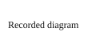

# Archived harbor pilot

## Spec Set (Frozen)

[[docs/specs/experience/harbor-booking.md]]

## Stories In Scope (Frozen)

[[docs/specs/experience/harbor-booking.md#^SPEC-9001-US4|Satisfied story D]]

## Plan Approval
No approver recorded.

## Original Intended Delivery
Preserve the selected passenger outcome.

## Actual Delivered
No runtime delivery acceptance is claimed.

## Deviations
Different work log selection is an authored snapshot.

## Closure Checklist
- [x] Capture source evidence.
- [ ] Inspect the installed experience.

## Status
Resume after checking exact selected scope and authority.

## Execution Notes
First authored entry has no structured event date.

Second authored entry mentions 2027-01-01 as a proposed service date, not an event timestamp.

See [[docs/efforts/harbor-legacy/plan|Extensionless HTML plan]] and [[plan|Ambiguous plan]].

## Scope
Only the selected outcome.

## Spec Coverage Checklist
Read exact scope.

## Plan
Inspect, implement, verify, and record evidence.

## Compounding Follow-ups
None recorded.
